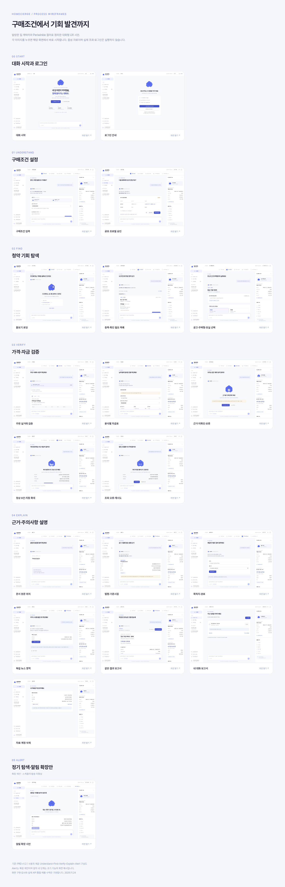

# 홈시어지 대화형 디자인 시안

캐릭터의 Periwinkle 컬러를 적용한 21개 화면이다. PRD v1.2와 사용자 제공 Understand → Find → Verify → Explain → Alert 구성도를 기준으로 만들었다. Alert는 정기 탐색·알림의 **확장 제안**이며 실제 발송을 하지 않는다. 모든 자료는 합성 예시이고 실제 인증·AI·외부 API를 실행하지 않는다.

## 바로 열어보기

1. [단독 HTML](homecierge-conversation.html)을 다운로드해 브라우저에서 연다. GitHub 파일 화면에서는 원본 파일 다운로드 버튼을 사용한다.
2. 왼쪽 **단계별 화면 목차**를 선택하면 각 단계의 예시 화면으로 이동할 수 있다. 상단의 화면 선택 메뉴도 사용할 수 있다.
3. 저장소를 실행할 때는 `/conversation.html`, 단계 목차는 `/conversation.html?view=flow`로 들어간다. 실제 연결 기능은 앱 기본 페이지에서 사용한다.



## 계속 수정하기

작업 브랜치: `backup/backend-foundation-20261123`.

| 수정할 것 | 원본 |
| --- | --- |
| HTML 골격 | [conversation.html](../public/conversation.html) |
| 색상·레이아웃·반응형·로딩 모션 | [conversation.css](../public/app/conversation.css) |
| 단계별 화면·선택·승인·합성 자료 | [conversation.js](../public/app/conversation.js) |
| 투명 캐릭터 PNG 7종 | [mascot](../public/app/brand/mascot/) |
| 화면별 기능·PRD 연결·검증 범위 | [UX 문서](../docs/conversation-mascot-ux.md) |

원본을 수정한 뒤 다음 명령으로 이 폴더의 단독 HTML을 다시 만든다. Node의 기본 모듈만 사용하며 네트워크·인증값은 필요 없다.

```sh
node scripts/export_conversation_design.mjs
```

원본과 생성된 HTML을 함께 커밋하면 다음 버전에서도 계속 수정할 수 있다. 생성된 HTML은 배포용이므로 원본 세 파일을 우선 편집한다. 내장 폰트의 이용 조건은 [Pretendard OFL](../public/app/licenses/Pretendard-OFL.txt)을 따른다.

보고서 보관은 탭 메모리에서만 시연하고 PDF는 브라우저 인쇄를 사용한다. 새로고침하면 시안 입력이 초기화된다. 제품 API 통합·계정 저장·실제 삭제·전체 PRD 수락 검수와 화면 시안을 구분한다.
