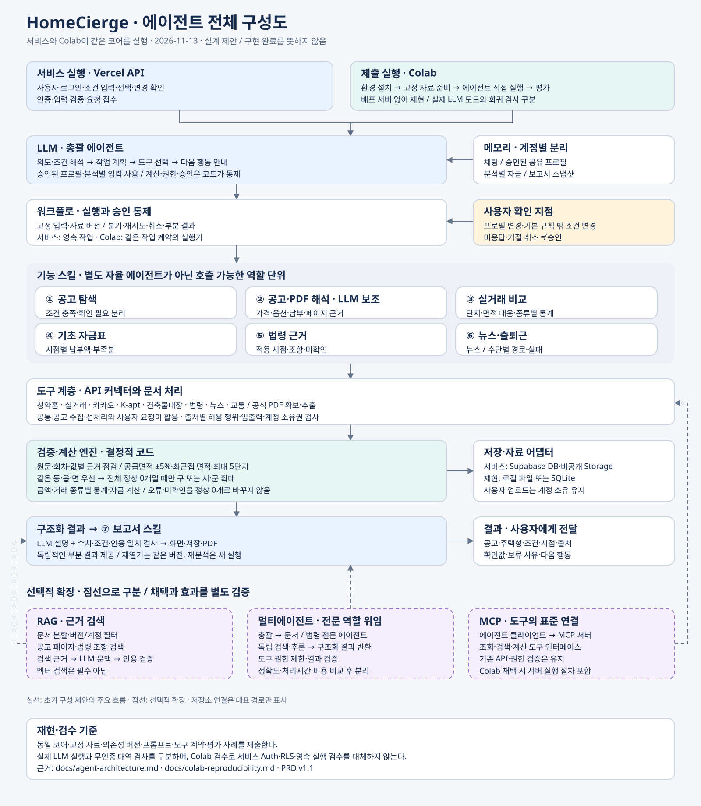
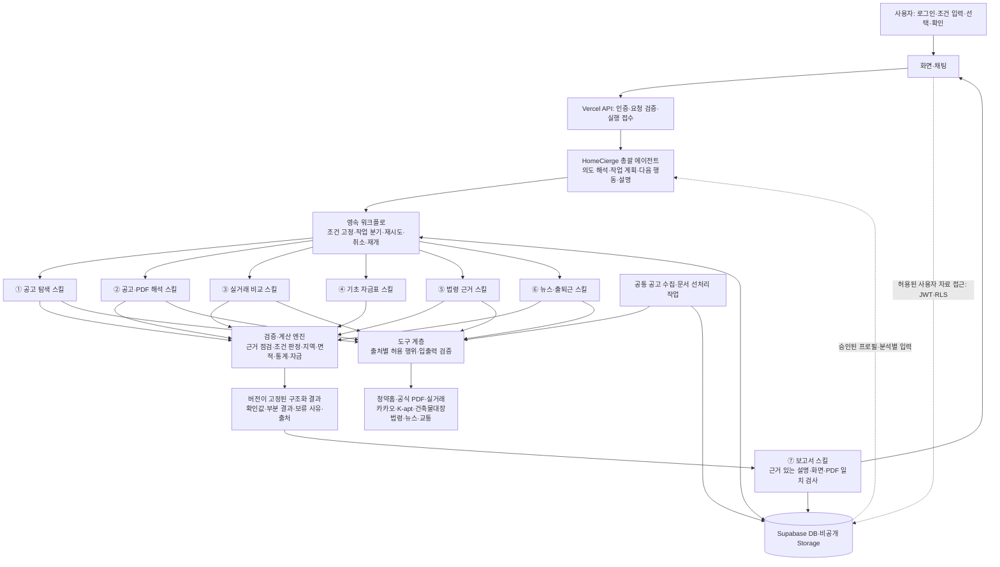
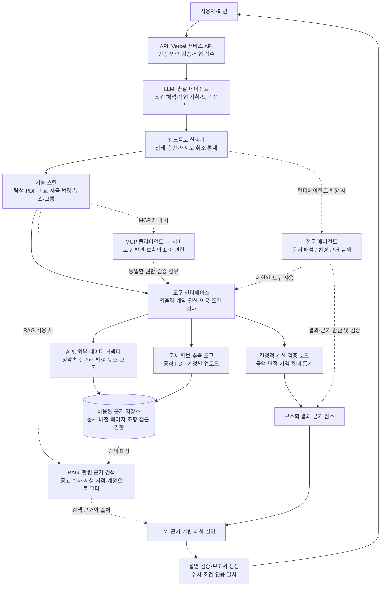
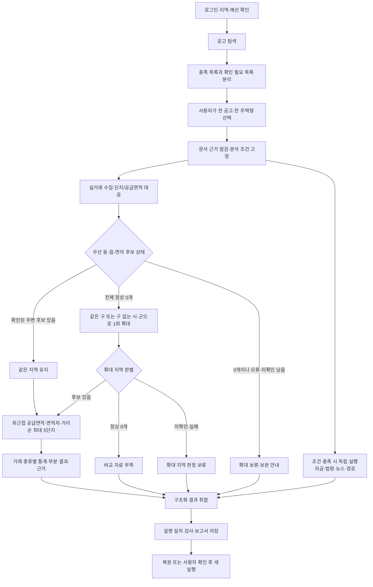
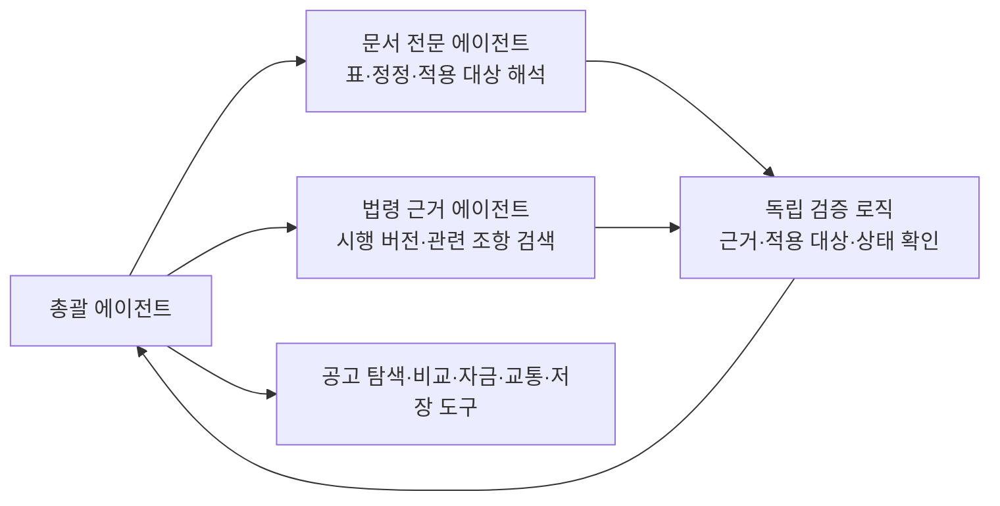

# HomeCierge 에이전트 구성도

작성일: 2026-11-12 · 상태: docs 기반 설계 제안 · 대상: 서비스 안에서 동작할 부동산 분석 에이전트

## 1. 설계 결론과 근거

**초기 구현은 총괄 에이전트 1개 + 7개 기능 스킬 + 결정적 검증·계산 엔진으로 구성한다.** 총괄은 필요한 작업을 선택하고 근거를 설명한다. 금액·면적·지역·통계·권한·승인 여부는 코드가 판정한다. 기능 모듈을 나눈 것만으로 멀티에이전트라고 부르지 않는다.

문서 기준은 PRD v1.1이다. 개발 계획·API 인계 문서 일부의 v1.0 표기나 옛 절 번호보다 최신 PRD의 요구를 우선한다. 아래 구성요소 이름·인터페이스·실행 구조는 새 제안이며 구현 완료를 뜻하지 않는다. 원격 서비스나 현재 코드의 실행 상태를 이번 작업에서 검증한 것은 아니다.

| 읽은 문서 | 설계에 반영한 내용 |
| --- | --- |
| [PRD v1.1](https://github.com/95sionkim/HomeCierge/blob/main/docs/prd/01-product-prd.md) §7.1~7.6, §8, §12 | R-01~R-18, Agent/Skill/Tool/Memory 경계, 모델 평가와 수락 기준 |
| [서비스 흐름](https://github.com/95sionkim/HomeCierge/blob/main/docs/service-flow.md) | 공고 선처리 → 탐색 → 단일 선택 → 비교·보조 정보 → 저장·복원 |
| [개발 계획](https://github.com/95sionkim/HomeCierge/blob/main/docs/development-plan.md) | 영속 실행, 재시도·취소·삭제 경합, 단계별 구축 |
| [화면 인계](https://github.com/95sionkim/HomeCierge/blob/main/docs/frontend-handoff.md), [인프라](https://github.com/95sionkim/HomeCierge/blob/main/docs/infrastructure.md) | 기존 인증·RLS·프로필 승인 계약, 현재 조회 API와 미구현 기능 구분 |
| [API 준비 상태](https://github.com/95sionkim/HomeCierge/blob/main/docs/api/prd-readiness.md), [데이터 대응](https://github.com/95sionkim/HomeCierge/blob/main/docs/api/data-requirements.md) | 공급면적 대응·자동차 경로 등 남은 자료 검증 |
| [데이터 관리](https://github.com/95sionkim/HomeCierge/blob/main/docs/data-handling.md), [결정 기록](https://github.com/95sionkim/HomeCierge/blob/main/docs/prd/02-decision-log.md) | 출처별 이용 조건, 계정 소유 자료, D-01~D-07 미정 사항 |

## 2. 전체 구성도

[SVG 원본 보기·다운로드](diagrams/agent-architecture.svg) — LLM·API의 위치와 RAG·멀티에이전트·MCP의 선택적 확장을 한 장에 표시한다. 2026-11-13 작성, 설계 제안이며 구현 완료를 뜻하지 않는다.

실선은 주요 호출·결과 흐름, 점선은 참조·보조 관계다. 스킬은 총괄이 호출하는 기능 단위이며 각자 별도 LLM을 실행한다는 의미가 아니다.

공통 수집은 사용자 요청과 독립된 백그라운드 작업이다. 별도 자율 에이전트가 필수는 아니다. 선처리 주기와 작업 실행 서비스는 미정이며, 누락 자료는 요청 시 보완할 수 있다. 사용자 업로드와 추출값은 계정 소유로 유지하고 공통 카탈로그에 자동 편입하지 않는다.

### 2.1 기술 요소를 표시한 구성도

아래는 기술 배치를 보여 주는 설계도다. 실선은 초기 구성 제안, 점선은 선택적 확장 경로다. 모든 기술을 이미 구현하거나 채택했다는 뜻은 아니다.

| 기술 요소 | HomeCierge에서의 위치와 역할 | 적용 상태·경계 |
| --- | --- | --- |
| **LLM** | 총괄의 요청 해석·계획, PDF 구조화 보조, 근거 기반 한국어 설명 | 초기 구성 제안. PRD 기준 모델의 실호출·품질 검증 필요. 계산·승인·권한의 최종 판정은 코드 |
| **API** | 화면↔서비스, 도구↔청약홈·실거래·법령·뉴스·교통 등 외부 출처 연결 | 문서상 인증 조회 API 기반은 준비됨. 제품 기능 API와 외부 커넥터 통합은 후속 구현이며 이번에 실행 검증하지 않음 |
| **RAG** | 공고 PDF·법령에서 관련 근거를 검색해 LLM에 전달하고 페이지·조항·버전을 답변에 연결 | 선택적 적용 제안. 저장소가 있다는 것만으로 RAG가 되지는 않으며 검색→근거 주입→응답 연결이 필요. 벡터 검색은 필수 아님 |
| **멀티에이전트** | 총괄이 문서 전문·법령 근거 에이전트에 작업을 위임하고 구조화 결과를 받아 검증 | 선택적 확장안. 초기의 7개 스킬은 별도 자율 에이전트가 아님. 분리 효과를 정확도·시간·비용으로 비교 |
| **MCP** | 에이전트가 사용하는 조회·검색·계산 도구를 표준 인터페이스로 연결 | 선택적 확장안. 최초에는 직접 도구 호출 가능. 채택해도 외부 API 커넥터와 권한 검증을 대체하지 않음 |

RAG 데이터 흐름은 **이용 가능한 문서 확보 → 페이지/조항 단위 분할 및 버전·소유권 기록 → 조건에 맞는 근거 검색 → LLM 문맥에 근거 전달 → 인용·수치 검증**으로 제안한다. 계정 소유 문서는 검색 단계에서 접근 범위를 제한하고, 법령은 질문의 적용 시점에 맞는 버전을 검색한다. 실거래 통계와 가격 판정은 검색된 문장 대신 검증된 구조화 데이터와 계산 도구를 사용한다.

멀티에이전트와 MCP는 서로 독립적인 선택이다. 여러 에이전트가 직접 API 도구를 사용할 수도 있고, 단일 총괄이 MCP로 도구를 사용할 수도 있다. 평가 발표에서는 실제 적용한 요소와 설계상 확장 요소를 구분해 표시한다.

## 3. 역할과 입출력

| 구성요소 | 받는 입력 → 만드는 결과 | LLM과 도구의 역할 | 요구 연결 |
| --- | --- | --- | --- |
| 총괄 에이전트 | 사용자 요청·승인된 프로필·현재 실행 상태 → 조건 제안·작업 계획·확인 요청·다음 행동 | LLM은 의도/조건 추출과 도구 호출 제안. 실행 가능 여부는 서버 검증 | R-11~R-14 |
| ① 공고 탐색 | 지역·예산·선택 면적/입주 기간 → 충족 목록·확인 필요 목록·미수집 범위 | 공고 DB 조회, 누락 수집 요청. 같은 주택형·호실의 조건 동시 충족은 코드 판정 | R-01·R-15 |
| ② 공고·PDF 해석 | 공고/회차·주택형·공식 PDF 또는 업로드 → 호실 가격·옵션·납부 일정·조건·페이지 근거·값별 점검 상태 | 문서 추출 도구와 LLM이 후보 값을 구조화. 회차·대상·단위·합계·원문 대응 검증 후 사용 | R-01~R-03 |
| ③ 실거래 비교 | 선택 공고·주택형·기간·면적 기준·거래 종류 → 주변 최대 5단지·종류별 통계·자체 거래·보류 | 수집·단지 식별·공식 공급면적 대응 도구. 지역 확대·순위·통계는 코드 | R-04~R-09·R-14 |
| ④ 기초 자금표 | 검증된 납부 일정·현재 자금·날짜별 추가 자금 → 시점별 납부액·부족분·확정/예상 가정 | 날짜별 계산 도구. LLM은 설명만 보조하며 대출 승인·세금 확정 금지 | R-16 |
| ⑤ 법령 근거 | 공고 조건·적용 기준시점 → 관련 조항·시행 버전·근거·미확인 예외 | 버전 필터를 적용한 법령 검색과 근거 설명. 개인 자격 자동 확정 금지 | R-17 |
| ⑥ 뉴스·출퇴근 | 공고 지역 / 단지 위치·목적지·수단별 조건 → 뉴스 카드 / 수단별 경로·실패 상태 | 내부적으로 독립 도구 두 묶음. 뉴스 본문 요약은 이용 조건 확인 전 실행하지 않음. 교통 시간을 LLM이 생성하지 않음 | R-10·R-18 |
| ⑦ 보고서 | 동일 버전의 구조화 결과·근거 → 한국어 설명·저장 보고서·PDF | LLM은 근거 있는 문장 작성. 수치·조건·인용 일치 검사와 저장/렌더링은 코드 | R-11 |

계정·메모리·승인은 모든 역할의 공통 기반이다. LLM에게 DB 직접 수정 권한을 주지 않는다. 총괄이 만든 변경 제안은 승인 인터페이스를 통과해야 하며, 기존 `decide_profile_change`의 기준 버전·거절·취소 계약을 유지한다.

## 4. 실제 작업 흐름과 분기

일부 후보가 확인됐더라도 미확인이 순위를 바꿀 수 있으면 완전한 순위로 표시하지 않는다. 독립 결과는 먼저 제공한다. 가격 근거 보류가 뉴스·경로 등 독립 기능을 모두 중단시키지 않는다.

필수 분기 규칙:

1. 공고 예산은 분양가+필수 옵션으로 판정한다. 옵션 미확인을 0원으로 채우거나 API 최고금액을 호실 가격으로 쓰지 않는다.
2. 비교는 공급면적 기본 ±5% 안의 단지별 최근접 면적을 사용한다. 전용면적이나 과거 5km 시험으로 대체하지 않는다.
3. 전체 고유 주변 단지는 최대 5개다. 매매·분양권·입주권 통계는 분리하고 자체 거래는 별도 표시한다.
4. 유효 거래 1건도 포함하며 1~2건은 적은 표본으로 표시한다. 후보 부족만으로 지역이나 면적을 완화하지 않는다.
5. 전체 정상 0개에 따른 기본 확대는 자동 수행한다. 그 밖의 지역·기간·면적 변경과 단지 교체는 사용자 확인 후 새 실행에 반영한다.
6. 공유 프로필 승인은 분석 조건 변경 승인과 별개다. 미응답·거절·취소를 승인으로 해석하지 않는다.
7. 저장·재열기·PDF 생성은 같은 결과 버전을 사용한다. 최신 자료 재분석은 새 실행이며 기존 보고서를 덮어쓰지 않는다.

## 5. 에이전트 간 전달 대신 구조화된 작업 계약을 사용한다

다음은 인터페이스 제안이다. 기존 DB 열이나 확정 API 스키마를 뜻하지 않는다.

| 계약 | 최소 전달 내용 |
| --- | --- |
| 작업 요청 | 서버가 확인한 소유자, 분석/실행 ID, 입력 버전, 공고·주택형, 적용 조건, 필요한 작업과 근거 참조 |
| 작업 결과 | 구성요소, 실행 상태, 자료 판정, 값·단위·적용 대상, 출처/페이지/시점, 수집 완전성, 보류 사유, 다음 행동 |
| 변경 제안 | 이전 값·새 값, 변경 대상이 프로필인지 분석인지, 근거, 기준 버전, 사용자 결정 상태 |
| 최종 결과 | 공고·주택형·조건·자료/규칙 버전, 구성요소별 결과, 통계·근거·누락, 생성 시점 |

실행 상태(대기/실행/완료/실패/취소)와 자료 판정(확인/정상 0건/부분/미확인/충돌)은 분리한다. 작업이 끝났어도 자료는 미확인일 수 있다. 구체 상태 어휘는 구현 계약에서 확정한다.

도구 실행기는 인증·출처별 허용 행위·스키마·중복 요청을 검사한다. 오래 걸리는 작업은 DB에 접수한 후 응답하고, 재시도·임대 만료·취소·삭제 시 오래된 작업자의 쓰기를 차단한다. API 함수의 실행 시간 안에 전체 분석을 억지로 묶지 않는다. 작업 실행 런타임은 계측 후 선택한다.

## 6. 메모리·근거 검색·모델

| 메모리 | 읽고 쓰는 경계 |
| --- | --- |
| 채팅 기록 | 계정·채팅별로 분리. 다른 채팅의 제안을 승인된 사실로 읽지 않음 |
| 공유 프로필 | 승인된 탐색 조건·목적지만 재사용. 상세 자금 제외 |
| 분석별 입력 | 선택 공고·주택형·호실·기간·면적·상세 자금·확인 이력 |
| 보고서 스냅샷 | 당시 수치·근거·조건·미확인 유지. 새 프로필로 덮어쓰기 금지 |
| 공통 근거 저장소 | 출처별 저장/재사용 허용 자료만 저장. 계정 업로드와 접근 경계 분리 |

**근거 검색 제안:** 공고 문서는 공고/회차/주택형/페이지로, 법령은 적용 시점/시행 버전/조항으로 먼저 좁힌다. 의미 검색이 필요한 경우 RAG를 추가하되 검색된 문장만으로 금액이나 자격을 확정하지 않는다. 벡터 DB·임베딩 모델·MCP 도입은 확정하지 않는다. MCP는 도구 공개 방식의 선택이며 에이전트 역할을 대신하지 않는다.

**모델:** PRD §7.6에 기록된 초기 기준 모델은 `gpt-6.1-sol` 선정 제안이다. Terra·Luna 대안과 선택적 Astra 평가는 동일 자료·도구·테스트셋으로 별도 실행한다. 이 문서는 모델 가용성·가격·실호출을 새로 검증하지 않았으며 역할별 모델 배치나 자동 전환을 확정하지 않는다.

문서·뉴스·PDF 안의 문장은 외부 자료로 취급한다. 그 안의 명령으로 도구 권한이나 사용자 승인을 바꾸지 않는다. 설명이 구조화 결과와 다르면 해당 설명을 출력하지 않고 검증된 값과 정형 설명으로 대체하는 방식을 제안한다.

## 7. 멀티에이전트로 확장할 경우

초기 단일 총괄 구성을 기준선으로 평가한 뒤, 독립적인 검색·추론이 개선 효과를 보일 때 아래 전문 에이전트를 분리한다. 서로 자유 대화하는 방식보다 총괄이 작업 계약으로 위임하고 결과를 검증하는 구조를 권고한다.

문서 전문 에이전트는 공고와 필요한 문서 참조만 받고, 법령 에이전트는 공고 조건·기준시점과 필요한 근거만 받는다. 둘 다 공유 프로필을 수정하거나 자격을 확정하지 않는다. 입력 최소화와 계정 격리를 유지한다. LLM 검토를 추가해도 필수 검증 로직을 대체하지 않는다.

분리 효과는 추출/근거 정확도·올바른 보류·전체 작업 성공률·처리시간·작업당 비용으로 측정한다. 근거가 없는 사례에 더 많은 에이전트를 호출해 값을 추측하지 않는다.

## 8. 구현 순서와 확인할 사항

1. **계약·도구:** 구조화 입력/출력, 오류·부분 수집 구분, 공고/거래 커넥터, 최소 문서 근거를 만든다.
2. **저장·실행:** 계정 권한, 고정 입력, 영속 작업, 재시도·취소·삭제 차단을 연결한다.
3. **첫 종단 분석:** 합성 한 공고·한 주택형으로 비교·저장·복원까지 완성하고 허용된 실자료로 대조한다.
4. **탐색·문서 확장:** 공고 유형, 선처리, 자동 점검, 충족/확인 필요 목록을 완성한다.
5. **총괄·보고서:** 자연어 조건 추출, 승인, 설명 검증, 동일 결과의 화면·PDF 출력을 연결한다.
6. **보조 기능·통합:** 자금·법령·뉴스·교통을 연결하고 실제 화면·계정·기기 간 복원을 확인한다. 이 기능들은 초기 출시 필수이며 후속으로 제외하지 않는다.

확인이 남은 사항은 공식 공급면적 대응 자료(D-01), 지역/기간 경계·갱신(D-02), 동률·대표 좌표(D-03), 정정·PDF 점검·자금 같은 날 순서(D-04), 평가 기준(D-05), 최종 모델·삭제 범위(D-06), 자동차 경로와 출처별 저장/LLM/내보내기 허용(D-07)이다. 미정 항목은 영향받는 판정을 보류하며 독립적인 기능 개발은 진행한다.

검수는 정상 탐색·정상 0개 확대·미확인 시 확대 보류·다른 회차 PDF·작은 표본·API 오류·프로필 거절·계정 격리·삭제 중 작업 완료·화면/대화/PDF 일치를 포함한다. PRD A-01~A-59와 연결하고, 모델/프롬프트/규칙/자료 버전 및 호출·토큰·비용을 기록한다. 과거 API 시험 통과를 새 에이전트 성능으로 표시하지 않는다.

## 9. Colab 제출 경로

서비스는 Vercel·Supabase 구성을 유지하고, Colab은 같은 에이전트 코어를 직접 실행한다. 저장·외부 자료·작업 실행은 어댑터로 분리하며, 로컬 재현 검증과 실제 인증·RLS 검증을 구분한다. 노트북·데이터·환경·평가의 구체적인 제출 계획과 미구현 상태는 [Colab 재현·제출 계획](colab-reproducibility.md)을 따른다.

## 10. API 이름과 호출 시점

[API 호출·판단 흐름 상세](agent-api-flow.md)에 14개 조회의 이름·엔드포인트·입력·호출 조건, PDF 별도 경로, 내부 API와 Colab 실행, 재조회 기준 및 첨부 이미지와 PRD의 범위 차이를 정리했다. SVG 하단 A~H 묶음에서 호출 시점을 확인할 수 있다.
