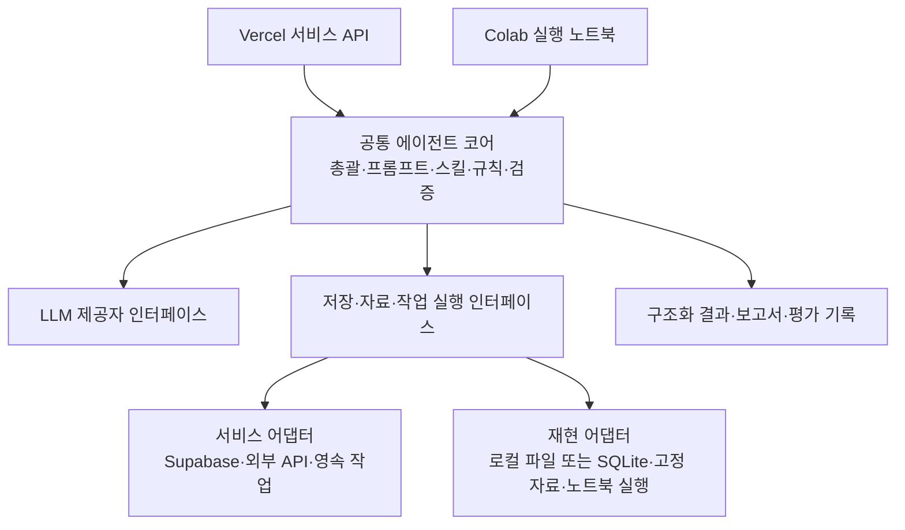

# HomeCierge Colab 재현·제출 계획

2026-11-12 · 상태: 제출 요구 대응 설계 / 실행 노트북·공통 코어 미구현

## 1. 제출 요구와 구현 상태

사용자가 전달한 교수자의 요구는 “에이전트 코드(Colab 실행가능 형태), 활용 데이터 등 재현 가능한 환경 일체”다. 이 문서는 그 요구에 대응하는 구현·검수 계획이다. API 키를 평가자가 제공하는 방식의 허용 여부와 제출 기능 범위는 교수자 확인이 남아 있다.

Vercel·Supabase 서비스 구성을 유지하면서, Colab에서 배포 서버 없이 공통 에이전트 코드를 직접 실행하는 경로를 추가한다. Vercel API만 호출하는 노트북이나 미리 저장한 답변 재생만으로 에이전트 재현을 완료했다고 표시하지 않는다.

이번 변경은 문서 추가다. 실행 가능한 노트북, 실제 LLM 호출, 데이터 패키지 또는 새 DB 기능이 완성된 상태가 아니다. 제품 요구는 [PRD](prd/01-product-prd.md), 역할은 [에이전트 구성도](agent-architecture.md)를 따른다.

## 2. 서비스와 제출본이 같은 코어를 실행한다



- Vercel은 인증·요청 접수·결과 전달을 맡고 핵심 분석 규칙을 독점하지 않는다.
- Supabase는 서비스의 DB·Auth·비공개 Storage를 유지한다. Colab 기본 재현 경로는 팀의 운영 DB·개인 계정·기존 배포 URL 없이 실행한다.
- 노트북은 공통 코어를 불러오는 실행 진입점이다. 서비스와 노트북에 가격·지역·통계 로직을 별도로 복사하지 않는다.
- Python 코어는 Colab 편의성을 위한 권고이며 언어 전환 확정이 아니다. 기존 TypeScript와 Python 자산을 검토해 언어·호출 경계를 기록한다. TypeScript를 유지하면 Colab에서 필요한 Node 런타임과 잠금 파일 기반 설치·실행까지 자동화한다.
- 서비스용 영속 작업과 노트북의 단일 실행기는 같은 작업 입출력 계약을 사용한다. 노트북의 성공을 운영 큐의 중복·임대·재시작 내구성 검증으로 해석하지 않는다.
- 서비스의 로그인·RLS·프로필 승인 정책을 바꾸지 않는다. Colab의 합성 계정 문맥은 평가용 대역이며 실제 Auth·RLS 검증은 별도다.

## 3. 실행 모드를 명시한다

| 모드 | 입력·연결 | 검증하는 범위와 한계 |
| --- | --- | --- |
| 고정 자료 + 실제 LLM | 제출 가능한 고정 문서·거래 데이터, 평가자의 LLM 키 | 실제 계획·도구 호출·근거 설명을 실행하면서 자료 변동을 통제. 키·비용·모델 접근 필요 |
| 무인증 회귀 검사 | 합성 자료, 필요한 경우 명시적 LLM 응답 대역 | 계산·분기·오류·승인 계약 검증. 실제 모델 성능이나 에이전트 자율 수행의 증거로 사용하지 않음 |
| 실시간 통합 실행 | 허용된 외부 API, 필요 시 별도 시험 Supabase | 실제 연결과 데이터 흐름 검증. 키·쿼터·이용 조건 필요, 데이터 변동으로 결과가 달라질 수 있음 |

기본 평가 경로는 고정 자료 + 실제 LLM을 제안한다. 평가자 키 사용이 허용되지 않으면 공개 가중치 모델 등 대안을 별도 검증·합의해야 한다. 대안을 이미 지원한다고 가정하지 않는다. 키가 없거나 실패하면 명확하게 실행 불가/미실행으로 표시하며 대역 응답으로 조용히 전환하지 않는다.

## 4. 제출할 파일과 환경

다음 경로는 구현 시 만들 제출 패키지 제안이며 현재 파일이 존재한다는 뜻이 아니다.

```text
submission/
  HomeCierge.ipynb       설치 → 자료 준비 → 실제 에이전트 실행 → 평가
  README.md             실행 순서·모드·키·예상 비용·제약·검수 결과
  data/
    manifest.json       합성/실제 구분·출처·버전·해시·이용 조건
    synthetic/          공유 가능한 합성 공고·거래·오류·문서 사례
  evaluation/
    cases.json          입력·기대 판정·근거·허용 오차
    results/            비밀정보를 제거한 검수 결과
```

공통 코어·프롬프트는 저장소의 단일 위치에서 관리하고 노트북이 제출 커밋/태그의 코드를 사용한다. 언어별 의존성 잠금 파일, Python/Node 및 필요한 시스템 라이브러리 버전, OCR/PDF 도구와 모델 자산 설치 절차를 함께 제출한다. GPU가 필요하면 종류·메모리와 CPU 대체 가능 여부를 실제 검증해 명시한다.

노트북은 숨겨진 로컬 파일, 팀원 Google Drive 권한, 앞선 세션 변수에 의존하지 않는다. 초기화·설치·자료 검증·실행·결과 내보내기를 셀 순서로 제공한다. API 키는 실행 시 비밀 입력으로 받고 셀·출력·로그에 저장하지 않는다.

## 5. 활용 데이터와 기술 요소의 재현

기존 [데이터 관리 정책](data-handling.md)을 유지한다. 실제 API 응답·공고 PDF·뉴스·경로 자료를 이번 문서 추가를 이유로 Git에 올리지 않는다. 합성 자료는 합성이라고 표시하고 실제 데이터의 이용 허용을 대신하지 않는다.

실자료가 필요한 평가에는 출처·확보 시점·파일/내용 해시·적용 회차·처리 절차·허용된 공유 경로를 기록한다. 재배포가 불가하면 공식 확보 절차와 합성 대체 사례를 제공하고, 원자료 미포함으로 재현하지 못하는 범위를 명시한다. 링크만 제공한 것을 동일 자료 확보·재현 완료로 표시하지 않는다. 데이터 제출 방식이 요구를 충족하는지는 별도 확인한다.

| 기술 | 제출 시 포함할 항목 |
| --- | --- |
| LLM | 모델 ID·설정·프롬프트·도구 스키마·재시도/중단 조건·호출/토큰/비용 기록 |
| API | 커넥터·정규화 코드·필요 키 이름·고정 합성 응답·실시간 실행 절차 |
| RAG 채택 시 | 공유 가능한 근거 자료·분할/버전 필터·검색 코드·인덱스 재생성·임베딩 모델/버전·인용 평가 |
| 멀티에이전트 채택 시 | 역할별 프롬프트·도구 권한·위임/취합 코드·상태·실행 추적 |
| MCP 채택 시 | 서버 코드 또는 고정 의존성·설정 템플릿·Colab 시작/종료 절차·연결 검수 |
| 저장소 | 로컬 초기 데이터·초기화 코드, 서비스 스키마/마이그레이션과 별도 통합 검수 절차 |

선택적 기술을 구성도에 표시했다는 이유만으로 구현 완료 또는 제출 필수 요소로 바꾸지 않는다. 외부 문서의 보관·LLM 입력·보고서 내보내기는 각각 출처별 허용 범위를 따른다.

## 6. 깨끗한 Colab 환경에서 검수한다

1. 새 런타임에서 제출 버전을 확보하고 모든 셀을 위에서부터 실행한다.
2. 팀 배포 URL·운영 Supabase·개인 Drive 없이 고정 자료를 준비한다.
3. 실제 LLM 모드에서 조건 입력 → 도구 호출 → 검증 → 보고서를 실행하고 호출·분기 근거를 기록한다.
4. 정상 후보, 전체 정상 0개 확대, 부분 수집 시 확대 보류, 다른 회차 PDF, 작은 표본, 거절/취소, 출력 일치 사례를 평가한다.
5. 고정 입력·규칙의 계산값과 판정은 기대값과 대조한다. LLM 문장은 글자 단위 동일성 대신 근거 정확성·요구 충족·불확실성 표현으로 평가한다.
6. 코드·모델·프롬프트·자료 버전, 런타임, 처리시간, 비용, 통과/실패/미실행을 남긴다.
7. 런타임 초기화 후 다시 실행하고 결과 파일을 내보낼 수 있는지 확인한다.
8. 서비스의 실제 인증·RLS·Storage·삭제·영속 실행은 별도 통합 검수한다. Colab 결과로 대체하지 않는다.

Colab 가상 머신은 유휴 상태와 최대 수명에 따라 삭제될 수 있으므로 설치·자료 준비를 재실행 가능하게 만든다. [Colab 공식 FAQ](https://research.google.com/colaboratory/intl/en-GB/faq.html)

검수 전에는 “Colab 실행 검증 완료”를 표시하지 않는다. 교수자 확인이 필요한 항목은 평가자 API 키·유료 호출 허용, 실자료 제출 방식, 필수 시연 범위와 실행 시간 제한이다.

## 7. 기존 개발 단계에 반영한다

- B1: 공통 도구 입출력·코어 경계·합성 데이터 재생 계약을 정한다.
- B2: 저장 인터페이스와 서비스/로컬 어댑터를 분리한다.
- B3: 같은 코어의 합성 종단 실행을 Colab에서도 재현한다.
- B4~B6: 문서·탐색·대화·보고서·보조 기능의 데이터와 평가 사례를 함께 보완한다.
- B7~B8: 새 Colab 런타임 검수와 서비스 통합 검수를 각각 기록하고 제출 버전을 고정한다.

이는 개발 계획의 추가 제출 경로이며 R-01~R-18과 A-01~A-59를 축소하거나 Vercel·Supabase 선택을 취소하지 않는다.
