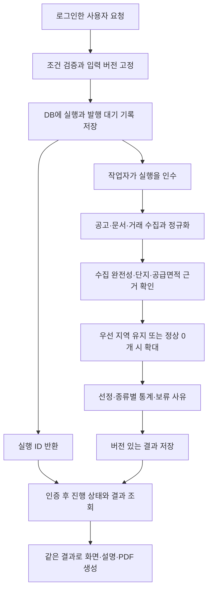

# HomeCierge 전체 개발 계획 — 기초 개발 우선

2026-11-11. Claude Fable 5.2 max의 계획 초안을 저장소·PRD와 대조하고 단계 순서와 실행 조건을 보완한 **개발 계획 제안본**이다. 제품 요구의 기준은 [PRD v1.0](prd/01-product-prd.md)이며, 이 문서는 R/P/D/E/A의 상태를 바꾸지 않는다. 계획 작성은 기능 구현·제품 수락·운영 활성화 완료를 뜻하지 않는다.

**권고 순서는 API 계약과 연결 → 데이터 정규화·DB 저장 → 비동기 작업과 비교 흐름 → 공고 문서·탐색 확장 → 계정·보고서·보조 기능 → 화면 통합·출시 검수다.** 공급면적 대응·권리 식별·PDF 자동 점검의 실자료 검증은 첫 단계부터 병행한다. 화면 팀은 API 명세와 합성 예시로 병행 개발하고, 화면 프레임워크와 디자인은 별도로 인계한다.

## 1. 출발점과 첫 완료 목표를 구분한다

계획 기준 커밋은 `7aad428`이다. 코드·마이그레이션은 이번 검토에서 확인했고, 원격 적용·배포·검사 이력은 [인프라 기록](infrastructure.md)을 기준으로 삼았다. 이번 계획 작업에서 클라우드 상태나 제품 테스트를 다시 검증하지 않았다.

| 준비된 자산을 확인한다 | 남은 개발을 구분한다 |
| --- | --- |
| Supabase 개발 DB, 마이그레이션 2개, 12개 테이블, 행 수준 보안(RLS), 프로필 승인 함수와 생성 타입 | 거래·가격·옵션·근거·수집 페이지·작업 실행 모델, 실제 Auth 통합, Storage, 삭제 실행 |
| Vercel의 독립 TypeScript API와 로컬 실행기 | 현재 GET 조회만 지원. 쓰기 요청의 본문 처리·검증·CORS, 분석 실행·취소·결과 조회 API 필요 |
| 보호된 Preview 배포와 환경 분리 | Git 자동 배포, 운영 DB·Production 설정, 작업 실행 런타임은 별도 설계·검증 |
| Python의 조회·수집·정규화·PDF 및 과거 검증 도구 | 인증값 정제 결함 수정, 제품 계약에 맞춘 연결. 과거 5km·전용면적 비교는 현행 엔진으로 재사용하지 않음 |
| DB 12개·API 8개·Python 26개 검사 통과 기록 | 새 제품의 수락 기준 A-01~A-59 검증은 별도. 실제 로그인·유효 사용자 요청의 통합 검수도 남음 |

첫 완료 목표는 **화면 없이 한 공고·한 주택형의 분석 요청이 인증 → 수집 → 정규화 → DB → 비교 → 저장된 결과 조회로 이어지는 것**이다. 정상 결과뿐 아니라 면적 미확인·부분 수집·다른 회차·재시도·취소를 같은 흐름에서 재현한다. 처음부터 여러 공고와 모든 서식을 자동 처리하는 것을 첫 완료 조건으로 잡지 않는다.

| 이정표를 구분한다 | 완료를 입증한다 | 아직 입증하지 않은 범위를 남긴다 |
| --- | --- | --- |
| M1-a: 오프라인 종단 흐름 | 합성 공고·가격 근거·거래로 저장·작업·비교·결과 조회, 인증 대역과 두 계정 권한 검사 | 실제 Auth, 실자료 대응, 외부 호출 |
| M1-b: 실제 인증 연결 | 별도 시험 계정 두 개의 실제 로그인·토큰 갱신, API·DB·Storage 접근 경계와 합성 분석 복원 | 로그인 수단의 제품 채택, 실제 공급면적 비교 성립 |
| M2: 통제된 실자료 한 사례 | 이용 조건이 확인된 공고·문서·거래로 수작업 기준 결과와 대조. 성공·보류·제외와 분모 기록 | 전 지역·전 공고 유형의 정확도와 사용자 가치 |
| M3: 초기 기능 API 완성 | 탐색·비교·보조 기능·대화·승인·저장·삭제·PDF의 기능별 검수 기록 | 실제 화면 통합과 출시 승인 |
| M4: 출시 준비 | 전체 A-01~A-59, 지원 자료 범위, 화면·운영·사용자 검토의 근거와 남은 제한 기록 | 수행하지 않은 조사나 다른 지역·자료로의 일반화 |

M1은 합성 성공을 제품 성립으로 해석하지 않기 위한 개발 이정표다. M2는 비교 기능을 넓히기 전의 필수 점검이며, 핵심 자료가 성립하지 않으면 관련 확장을 멈추고 근거를 사용자에게 제시한다. 일반 API·DB·인증 작업은 독립적으로 계속할 수 있다.

## 2. 전체 순서와 완료 조건을 정한다

아래 B 번호는 개발 단계이며 PRD의 설계 제안 P 번호와 다르다. 한 명이면 의존 순서대로 진행하고, 인력이 있으면 B4의 문서 처리와 B3의 비교 엔진, B5·B6을 병행한다.

| 단계에서 진행한다 | 만들 결과를 정한다 | 다음 단계에 넘길 근거를 확인한다 |
| --- | --- | --- |
| **B0. 계약·위험 검증을 시작한다** | 기준 자산·요구 대응표, 출처별 이용 조건, 데이터·결과 계약 v0, 실자료 검증 과제 V1~V6 | 미구현/과거 검증 구분, 선행 결정과 검증 담당 지정. B1과 병행 가능 |
| **B1. API와 정규화를 만든다** | 인증값 정제 수정, 커넥터 공통부, 공고·주택형·최소 가격/문서 근거·거래의 정규화, 재생용 합성 응답, 화면 계약 v0 | HTTP/업무 오류·정상 빈 응답·부분 수집 구분. 단위·식별자·근거 보존. 핵심 경계 검사 |
| **B2. DB 저장과 권한을 연결한다** | 최소 추가 마이그레이션, 수집/페이지/관측값·근거·고정 입력 저장, 실제 Auth 시험, 비공개 파일·삭제 의존관계의 기반 | 재적재 시 결과 중복·덮어쓰기 방지, 두 계정 격리, 사용자 업로드의 공유 카탈로그 유입 차단 |
| **B3. 실행 흐름과 비교를 완성한다** | 요청 접수·작업 실행·재시도·취소·조회, 지역 판정·공급면적·5단지·통계 엔진, 결과 스냅샷 | 먼저 M1-a/b, 이후 결정된 규칙의 비교 경계와 M2. 보류를 정상 0개로 바꾸지 않음 |
| **B4. 공고 문서와 조건 탐색을 확장한다** | 지원 유형별 공식 PDF 자동 확보·업로드 보완·정정 처리·자동 점검, 호실/옵션/납부 일정, 조건 충족·확인 필요 목록 | 미확인 옵션을 0원으로 채우지 않음. 같은 주택형·호실에서 적용 조건 동시 충족, 출처·페이지·상태 일치 |
| **B5. 계정·대화·보고서를 완성한다** | 다중 채팅, 확인 후 공유 프로필·분석 조건 변경, 분석별 자금 저장, 결과 복원·설명·PDF, 개별/계정 삭제 | 승인 충돌·미응답·거절·취소 처리, 이전 결과 불변, 삭제 후 재생성/복원 방지. B2의 권한·파일 기반을 확장 |
| **B6. 초기 보조 기능을 연결한다** | 자금표, 법령 근거, 지역 뉴스, 대중교통·연결 도보·자동차 경로 | 입력·가정·시점·버전·누락 표시. 한 기능 실패가 독립적인 결과를 막지 않음. 모두 초기 출시 범위 유지 |
| **B7. 화면을 통합한다** | 별도 팀의 화면과 인증·탐색·분석·승인·저장·삭제 흐름 연결 | 실제 화면 origin·Auth 리다이렉트·배포 보호 확인. 모바일/다른 기기와 화면·대화·PDF 수치 일치 |
| **B8. 운영·출시를 검수한다** | 운영 DB·배포 절차, 관측·재처리·쿼터/비용 통제·백업 복구/삭제 정책, 전체 수락 기록 | M4. 개발 DB와 분리, 실제 제공자 조건·한도 확인, 운영 담당·대응 절차, 사용자 이해 검토 |

문서 확보·핵심 값 점검의 최소 계약은 B1부터 다룬다. B4로 미루는 것은 지원 서식 확대·자동 확보의 완성도이며, 비교 대상 공고의 면적·가격 근거 자체가 아니다. B4에 필요한 비공개 업로드와 삭제 차단은 B2에서 먼저 준비한다.

관측과 비용 계측은 B1부터, 변경 가능한 스키마의 호환성과 CI는 B2부터, 삭제와 작업 재개 경합은 B3부터 검사한다. 운영 품질을 B8에서 처음 도입하지 않는다. 일정은 인력·V1/V2 결과·문서 처리량을 확인한 뒤 M1-a 시점에 산정하며, 현재 정보로 주차별 출시일을 약속하지 않는다.

## 3. API·정규화 계약을 먼저 고정한다

커넥터는 **요청 → 전송 → 응답 해석 → 정규화**를 분리하고, 제품의 지역 확대·비교 선정은 별도 도메인 로직에서 처리한다. 기본 검사는 합성 응답 재생으로 수행하며 외부 네트워크와 인증값에 의존하지 않는다.

| 경계를 설계한다 | 보존하거나 검증할 내용을 정한다 |
| --- | --- |
| 요청 | 출처 ID, 허용 호스트·경로, 지역/월/페이지, 요청 범위, 제한 시간·바이트 상한, 인증 주입 방식 |
| 응답 | HTTP 상태와 업무 응답을 별도 해석. HTTP 200 안의 오류, 비정상 JSON/XML, 페이지 누락, 총건수 변경 구분 |
| 수집 완료 | 요청·지역·월·페이지별 성공/빈 응답/실패와 완료 증거. 한 응답의 0건을 전체 후보 정상 0개로 승격하지 않음 |
| 재시도 | 일시 네트워크 오류·408·429·재시도 가능한 5xx는 출처 조건과 `Retry-After`를 반영해 상한 있는 지연 재시도. 인증 실패·허용하지 않은 리다이렉트·크기 초과·스키마 불일치는 원인 확인. 모든 파싱 실패를 재시도하지 않음 |
| 로그 | 요청/실행 ID·시간·상태 코드·횟수·처리량 중심. 인증 헤더·URL 인증값·원문 오류·사용자 목적지/자금/대화 제외 |
| 출처 조건 | 조회·원문 저장·정규화값 저장·재사용·표시·LLM 전달·PDF 내보내기를 각각 확인. `unknown`과 `denied`는 구분하고 해당 행위는 수행하지 않음 |

수집·정규화를 전부 TypeScript로 이식하는 것을 착수 조건으로 삼지 않는다. 기존 TypeScript API와 새 제품 판정 로직을 중심으로 개발하되 Python 도구는 계약을 통해 재사용할 수 있다. 공통 로직을 이식하는 경우에만 동일 합성 입력의 차등 검사를 추가한다. 역사적 연결기의 누락 ID 정렬 결함은 그 도구를 재사용하기 전에 고치며, 사용하지 않는 경로의 수정으로 전체 API 작업을 막지 않는다.

| 정규화 대상을 구분한다 | 계약을 정한다 |
| --- | --- |
| 금액 | 원 단위 정수와 원래 값·단위를 함께 관리. API에서 큰 정수는 십진 문자열로 직렬화. 만원→원 변환을 기록하고 본체/필수 옵션/세금/금융비용을 분리 |
| 면적 | 공급·전용·공용을 별도 값·근거로 관리. 판정은 정밀 십진수로 하고 표시 반올림과 분리. ㎡↔평 계수·표시 정밀도는 D-01에서 확정 |
| 날짜 | 계약일은 날짜, 수집 시점은 시간대가 명확한 시각, 입주 예정은 월 또는 월 범위로 보존. 정확한 최근 1년 기간과 걸친 월 수집을 분리. 윤일·기준 시각은 D-02 |
| 공고 식별 | 출처·주택관리번호·공고번호·유형·주택형 번호를 보존하고 검증된 키로 연결. 회차마다 어느 번호가 바뀐다고 가정하지 않음. API의 주택형 최고금액은 호실 가격과 별개 |
| 지역 | 출처별 코드의 정의·길이와 법정동/읍/면/리 계층을 검증. 모든 API에 `sggCd`·`umdCd`가 있다고 가정하거나 단순 연결로 동일 코드를 만들지 않음 |
| 단지·면적 대응 | 출처별 단지 ID, 주소·좌표·면적 대응 근거·적용 시점·충돌을 보존. 이름·거리·전용면적 유사성만으로 확정하지 않음 |
| 거래 | 매매/분양권/입주권, 계약일·금액·면적·해제 상태·원문 위치를 보존. 정규화 성공/사전 자격/최종 비교 포함을 서로 다른 상태로 관리 |
| 문서·값 근거 | 공고/회차·확보 경로·문서 버전/해시·페이지·항목명·단위·적용 호실·추출 상태·점검 상태. 추출 성공이 점검 통과를 뜻하지 않음 |
| 결측·충돌 | 값과 함께 상태·이유 코드·출처·가능한 다음 행동을 보존. 빈 문자열, 0, 미제공, 조회 실패를 같은 값으로 바꾸지 않음 |

안정적인 거래 고유 ID가 없는 출처에서는 원문 행의 **중복 개수까지 보존**한다. 이름·날짜·층·금액이 같다는 이유로 제거하지 않는다. 재수집 비교는 관측값의 추가/사라짐을 기록하며, 안정적인 연결 근거 없이는 두 행을 하나의 거래에 대한 ‘정정 전/후’로 확정하지 않는다. 부분 수집에 없는 행을 삭제된 거래로 판단하지 않는다.

API 요청 지역과 제품의 비교 지역은 별도다. 상위 지역을 미리 수집했더라도 표시·판정은 우선 지역 규칙을 따른다. 확대 지역이 항상 하나의 5자리 API 요청과 같다고 가정하지 않고, **제품 지역 → 필요한 요청 집합 → 수집 완료 증거**의 대응을 만든다.

## 4. DB는 필요한 모델부터 단계적으로 확장한다

기존 12개 테이블과 적용된 두 마이그레이션은 출발점으로 유지하고, 변경은 새 마이그레이션으로 추가한다. 아래는 논리 모델 제안이며 테이블 개수·물리 분할·마이그레이션 번호를 미리 고정하지 않는다.

| 도입 시점을 정한다 | 추가·확장할 모델을 정한다 | 보호할 불변 조건을 정한다 |
| --- | --- | --- |
| B1~B2 | 출처별 계약/허용 행위, 수집 실행·요청/페이지, 스냅샷 메타데이터, 정규화 관측값 | 완료/부분/실패 분리. 출처·요청·스키마 버전·원문 참조. 원문 저장은 허용된 범위만 |
| B2 | 공고·회차·주택형, 최소 호실 가격/필수 옵션과 값별 문서 근거 | 공고와 문서의 연결 무결성. 사용자 업로드에서 나온 값은 계정 범위 유지 |
| B2~B3 | 지역 계층·단지 식별·면적 대응, 분석 고정 입력, 실행/작업/발행 대기 기록 | 미확인 근거를 확인됨으로 저장하지 않음. 소유권·멱등 키·실행 세대·삭제 상태 검증 |
| B3 | 분석 결과의 버전 있는 스냅샷과 근거 참조 | 같은 입력·규칙의 재현. 재조회는 새 결과, 저장된 결과를 덮어쓰지 않음 |
| B4 | 공고 정정/참조 관계, 호실·옵션 적용·납부 일정, 문서 처리 실행·점검 항목 | 최신 파일 시각만으로 정정 적용하지 않음. 값 단위 보류와 독립 결과 유지 |
| B5~B6 | 보고서 내보내기·삭제 작업, 분석 조건 변경 승인, 자금 계산·법령·뉴스·경로 결과 | 공유 프로필과 분석별 입력 분리. 출처별 보관/내보내기·개인정보 삭제 반영 |

조회에 자주 쓰는 식별자·소유자·지역·날짜·상태는 명시 열과 필요한 인덱스로 두고, 출처별 부가 필드와 불변 결과 묶음은 버전 있는 JSON을 사용할 수 있다. 모든 판정 단계마다 별도 테이블을 만드는 대신 초기에는 결과 스냅샷에 남기고, 실제 조회·검수·측정 수요가 확인된 항목을 분리한다.

현재 `notices`·`notice_documents`·`housing_types`는 로그인한 계정들이 읽는 카탈로그이고 `notice_documents.official_url`은 필수다. **사용자 업로드를 이 테이블의 공개 근거로 바로 승격하지 않는다.** 계정 소유 문서·값 근거를 분리하고, 공식 카탈로그로 승격할 조건은 별도로 정한다. 파일 해시가 같아도 계정 간 조회 허용을 뜻하지 않는다.

RLS와 열별 쓰기 권한을 새 모델에도 적용한다. API에서 받은 `user_id`를 신뢰하지 않고 인증 주체로 소유권을 결정한다. 사용자 HTTP 요청은 사용자 토큰과 제한된 DB 함수로 처리하고, 수집·보고서 생성 등 내부 작업 권한은 실행기에서만 사용한다. 기존 Data API 직접 접근이 허용된 열도 함께 검토해 새 API의 조건 검사를 우회할 수 없게 한다.

## 5. 분석 작업과 결과 상태를 분리한다

1. 인증·소유권·조건 검증 뒤 입력/프로필 버전·기준 시점·규칙 버전을 고정한다. 확정된 범위 밖의 조건 변경은 사용자 확인 기록이 필요하다.
2. 분석 실행과 작업 발행 대기 기록을 **하나의 DB 트랜잭션**으로 저장한 뒤 접수 응답을 반환한다. HTTP 응답 후 메모리에 남은 Promise만으로 실행을 보장하지 않는다.
3. 작업자는 임대(lease)와 실행 세대 토큰으로 작업을 인수한다. 재시작·재배달을 허용하되 같은 결과를 중복 기록하지 않으며, 임대가 끝난 이전 작업자의 쓰기를 거부한다.
4. 출처별 수집 상태를 저장하고 독립적으로 확인된 결과를 계산한다. 어떤 종류·지역·페이지가 미완료인지와 결과를 바꾸는 보류가 남았는지 확인한다.
5. 우선 지역에 후보가 있으면 그 지역을 유지한다. 전체 정상 0개인 경우에만 검증된 상위 지역으로 확대하고, 근거가 부족하면 필요한 보완 행동을 반환한다.
6. 결과는 입력·스냅샷·규칙 버전에 연결해 저장한다. 재조회·조건 변경은 새 실행을 만든다. 화면·대화·PDF는 같은 구조화 결과를 읽는다.

| 상태 축을 분리한다 | 계약을 제안한다 | 의미를 확인한다 |
| --- | --- | --- |
| 실행 상태 | `queued / running / retry_wait / finished / failed / cancelled` | 실제 작업이 대기·진행·종료됐는지 나타냄 |
| 결과 상태 | `complete / partial / unavailable`, 결과 생성 전에는 미설정 | 요청한 결과를 어느 범위까지 제공하는지 나타냄. 정상 0개도 근거가 완전하면 complete 가능 |
| 구성요소별 판정 | 확인됨·정상 0개·미확인·일부 수집·조회 실패·충돌·결정 필요 | 실행이 끝나도 자료 보류가 남을 수 있음. 사유·재시도 가능 여부·다음 행동 표시 |

이 어휘는 B1 계약 검토에서 확정할 설계안이다. 현재 `analyses.status`와 새 실행 상태를 두 독립 상태 기계로 갱신하지 않는다. 실행 기록을 기준으로 요약 상태를 산출하거나 원자적으로 갱신하고, 기존 값의 호환·변환 규칙을 새 마이그레이션에 포함한다. 결과가 전부 보류인데 ‘분석 완료’만 표시하거나, 작업이 없는데 ‘분석 중’으로 남기지 않는다.

취소는 해당 사용자의 실행에 먼저 적용한다. 공유 수집을 도입한다면 남은 소비자·허용 범위·비용을 확인한 경우에만 계속한다. 삭제는 쓰기 권한과 작업의 재개를 먼저 차단한 뒤 연관 데이터·파일을 정리해 늦게 끝난 작업이 삭제한 자료를 되살리지 못하게 한다.

결과 재현용 해시는 고정 입력·근거 스냅샷·규칙 버전과 정렬을 명시한 결과 내용으로 계산한다. 매 실행마다 달라지는 실행 ID·로그 시각은 별도 메타데이터로 둔다. 단순 총건수 일치를 동일 자료의 근거로 사용하지 않는다.

## 6. 작업 실행 기술은 작은 실험 뒤 선택한다

**권고안:** Vercel은 인증 HTTP API, Supabase는 데이터·인증·비공개 파일과 영속 작업 기록을 맡는다. 첫 실행기는 로컬 명령으로도 같은 작업 계약을 실행할 수 있게 만들고, M1-a에서 재시작·중복 처리·처리량을 확인한 뒤 클라우드 실행 경로를 고른다. 실제 서비스는 개발자 컴퓨터가 켜져 있어야 작동하는 구조로 출시하지 않는다.

**대안:** Supabase의 Postgres 기반 큐 또는 Vercel의 관리형 작업/워크플로를 검토한다. 제품의 작업 계약을 특정 실행기에 종속시키지 않고, 자체 큐를 만드는 운영 부담과 관리형 서비스의 제약을 함께 비교한다. Supabase Queues의 가시성 시간 내 전달 보장을 전체 분석이 반드시 한 번만 실행된다는 의미로 확대하지 않는다. [Supabase Queues 공식 문서](https://supabase.com/docs/guides/queues)

선정 실험에서는 페이지 수·PDF 처리 시간/메모리·재시도·동시 실행·작업자 종료·중복 전달·원격 Postgres 경합·제공자별 호출 제한을 측정한다. PGlite의 빠른 검사는 유지하되 여러 세션의 임대·잠금·경합을 입증하는 검사로 대신하지 않는다. PDF 라이브러리·Python/TypeScript 경계는 실제 서식·정확도·라이선스·실행 제약으로 정한다.

Vercel `waitUntil`은 함수와 제한 시간을 공유하므로 영속 작업 실행의 대체재로 삼지 않는다. 현재의 Preview에서 Vercel Cron 자동 실행을 기대하지 않고, 별도 인증된 수동 트리거로 개발 검수를 한다. 해당 Cron은 Production 배포에서 실행된다는 공식 제약을 확인했다. [Vercel 함수 API](https://vercel.com/docs/functions/functions-api-reference/vercel-functions-package), [Cron 관리 문서](https://vercel.com/docs/schedules/cron-jobs/manage-cron-jobs)

요금제별 한도·비용·리전·백업 보존·새 실행 서비스의 계정 이용 가능 여부는 선택 시 확인한다. 초안의 고정 실행 시간 수치나 미확인 키 전환 시한을 계획의 전제로 사용하지 않는다. 새 리소스/비용 또는 기존 승인을 넘어서는 운영 활성화가 필요하면 구체적인 구성과 비용을 만든 뒤 사용자에게 확인한다. 되돌릴 수 있는 로컬 구현 선택마다 별도 승인을 요구하지 않는다.

## 7. 데이터 성립 검증을 개발과 병행한다

| 검증 과제를 진행한다 | 남길 근거를 정한다 | 점검 시점과 영향을 정한다 |
| --- | --- | --- |
| **V1. 공급면적·단지·권리 식별** | 공식 공급면적 대응 경로·적용 시점·복수 대응, 매매/권리 필드의 실재와 의미, 주소/단지 충돌. 전체 검토 후보·확인·불일치·보류 수와 이유 | B1 시작과 동시 착수, B2 확장 전 중간 검토, M2 전 대표 사례 성립 확인. 실패 시 비교 관련 확장을 재검토 |
| **V2. 공고 문서·가격·정정** | 신규분양/무순위/잔여/재공급의 필드·PDF 경로, 스캔·복잡 표·다른 회차·같은 회차 정정의 기준 결과와 값별 오류/보류 | B1의 최소 근거 계약부터, B4 자동 점검과 탐색 확정 전에 검증 |
| **V3. 지역·시간 범위** | 법정동·읍/면/리·구 없는 시/군의 계층, 지역 미배정 행, 제품 지역과 API 요청 집합, 날짜 경계 | B2 지역 모델 검토 및 B3 실자료 지역 판정 전 |
| **V4. 출처 이용·운영** | 조회/저장/표시/재사용/LLM/PDF별 허용 범위·근거 URL·확인일·책임자, 쿼터·환경 제한·보존 조건 | 해당 출처의 해당 행위를 처음 수행하기 전. 개발 DB에 실자료 저장도 포함 |
| **V5. 법령·뉴스·교통·LLM** | 적용 시점 법령과 예외, 뉴스 지역성 한계, 자동차 출처·대중교통·도보 값/실패, LLM의 근거 충실도·비용·응답시간 | 출처 조사는 B0부터, 실험은 허용 범위 내 진행, B5/B6 기능 활성화 전 |
| **V6. 기준 결과·사용자 이해** | 대표 사례의 수작업 기준 결과, 대상 사용자의 가격 구성·면적/지역·적은 표본·보류 이해와 보완 부담 | M2의 정확성 대조, 화면 팀과 B7 조사 준비·수행. 분모·방법·목표는 D-05 |

V1의 실측 결과가 좋지 않아도 ±5%를 넓히거나 전용면적·거리 반경으로 바꾸지 않는다. 현행 요구를 유지한 성공/보류율과 원인을 보고하고, 제품 범위 변경은 그때 별도 합의한다. 이름·좌표만으로 단지를 확정하거나 보강 자료 요건을 임의로 낮추지 않는다.

출처 조건은 **해당 행위의 실행 조건**으로 사용한다. 한 출처의 PDF 내보내기가 미확인이라고 합성 자료 기반 DB·작업 실행·다른 출처의 허용된 검증까지 막지 않는다. 다만 허용되지 않은 자료를 저장해 놓고 나중에 조건을 확인하는 순서는 피한다. 저장 보고서 복원과 이용 조건이 양립하지 않으면 관련 출시 요구는 미완료로 남긴다.

## 8. 화면 팀에는 동작 계약을 일찍 넘긴다

현재 연결 방식은 [화면 팀 인계 계약](frontend-handoff.md)을 따른다. 아래 API 경로는 **구현 전 제안**이며 B1에서 기존 Data API 직접 접근과의 역할을 검토해 계약 v1으로 고정한다. 화면 팀에 전달할 자료를 작성하되 전달 메시지는 별도 요청 없이 보내지 않는다.

| 계약 묶음을 전달한다 | 포함할 내용을 정한다 |
| --- | --- |
| v0 — B1 | 인증/오류 형식, 금액·면적·날짜, 분석 실행/결과 상태, 보류 이유·다음 행동, 합성 정상/빈 결과/부분/실패 예시, 로컬 모의 응답 |
| v1 — M1-b | OpenAPI·공용 타입, 실제 인증과 실행/조회/취소 연결, 분석·프로필 버전, 멱등성·권한·페이지 처리, 로컬/Preview 검수 방법 |
| v2 — B4~B6 | 탐색 목록·PDF 보완·보조 기능·확인/승인·보고서·삭제의 계약과 상태별 응답, 지원 기능/미지원 상태 |

| 작업을 요청한다 | 경로를 제안한다 | 핵심 응답과 조건을 정한다 |
| --- | --- | --- |
| 공고를 탐색한다 | `POST /api/v1/notice-searches`, `GET /api/v1/notice-searches/{id}` | 검색 조건 고정, 충족/확인 필요/수집 상태 분리. 오래 걸리면 접수 후 조회 |
| 분석을 실행·조회한다 | `POST /api/v1/analyses/{id}/runs`, `GET /api/v1/runs/{id}` | 영속 접수 후 202, 실행/결과 상태와 근거 참조. 같은 계정·작업·멱등 키+동일 본문은 같은 접수, 다른 본문이면 충돌 |
| 실행을 취소한다 | `POST /api/v1/runs/{id}/cancel` | 소유자·현재 상태 확인, 이미 끝난 실행과 취소 중 상태 구분 |
| 문서를 보완한다 | 업로드 접수·완료·검수 상태 조회 API | 계정 소유의 비공개 저장, 파일 제한·형식 검증·삭제 경로. 문서 접수는 공식성/자동 점검 통과와 별개 |
| 변경을 확인한다 | 기존 프로필 승인 RPC와 분석 조건 변경 API | 이전/새 값·근거·기준 버전 표시. 분석 변경과 공유 프로필 승인 분리 |
| 보고서·삭제를 요청한다 | 보고서 저장/조회·PDF 내보내기·개별/계정 삭제 API | 같은 결과 버전, 소유권, 출처별 내보내기 조건, 삭제 영향·진행·완료 상태 |

새 POST 경로를 추가할 때 `dev/server.ts`의 본문 폐기 동작, 공통 핸들러의 GET 제한, 허용 메서드·헤더를 함께 변경한다. JSON 형식/크기/필드 검증과 사용자별 요청량 제한을 적용하고, 오류로 외부 원문이나 인증값을 반환하지 않는다. 화면용 모의 응답은 실제 API와 같은 스키마 검사를 통과해야 한다.

첫 사용부터 로그인하는 제품 정책은 유지한다. M1-b의 시험 로그인 수단은 출시 수단 선택과 별개다. B7을 기다리지 않고 API의 인증 만료·토큰 갱신·다른 계정 접근을 검수하며, 실제 화면에서 로그인 복귀와 세션 동작을 다시 검수한다.

## 9. 계정·파일·삭제를 초기 구조에 포함한다

사용자 업로드·보고서 PDF는 비공개 버킷과 계정 권한을 적용한다. 서명 URL을 쓰면 권한 확인 후 짧은 유효기간으로 발급하며 공개 카탈로그 URL과 혼용하지 않는다. Supabase의 비공개 버킷은 다운로드에도 접근 통제를 적용한다. [Storage 버킷 공식 문서](https://supabase.com/docs/guides/storage/buckets/fundamentals)

삭제 의존관계는 B2에서 설계하고 사용자 파일 업로드 전에 최소 정리 경로를 마련한다. B5에서 개별 자료·계정 삭제를 완성하며 분석 입력, 대화, 공유 프로필, 파생 보고서, 파일, 작업 큐·재시도, 로그·백업의 처리 범위와 완료 의미를 D-06에 연결한다. 입력을 삭제한 뒤 저장 보고서에서 다시 읽을 수 있는지까지 확인한다.

Auth 사용자 삭제만으로 이미 발급된 JWT가 즉시 무효화되지는 않으며, Storage 소유 객체는 사용자 삭제의 선행 처리 대상이다. 따라서 삭제 진행 계정의 API·직접 Data API·Storage 접근 및 작업 쓰기를 차단하는 경로와 파일 정리 순서를 함께 검증한다. 백업 보존과 복구 시 재삭제 절차는 실제 요금제·정책을 확인한 뒤 문서화한다. [Supabase 사용자 관리 공식 문서](https://supabase.com/docs/guides/auth/managing-user-data)

LLM은 구조화된 사실·계산 결과의 설명과 변경 제안을 보조한다. 지역 확대·금액 합산·통계·승인을 모델의 자유 응답으로 결정하지 않는다. 모델/호스팅과 입력 허용 범위를 정하기 전에는 결정적인 설명 틀로 흐름을 개발할 수 있다. 근거와 다른 수치·범위·진행 상태의 문장은 확정 출력하지 않는다.

## 10. 첫 작업을 다섯 묶음으로 실행한다

| 작업 묶음을 만든다 | 구현 범위를 정한다 | 완료를 확인한다 |
| --- | --- | --- |
| **BE-01. 계약과 안전한 응답 해석** | 상태·단위·오류·결과 스키마 v0, 인증값 정제 결함 수정, 원문 해석과 로그 정제 경계. V1~V4 조사 착수 | 짧은 합성 인증값·이스케이프·XML/JSON 구조 경계의 회귀 검사, 비밀 유출 방지, 기존 검사 유지. 다른 문서의 낡은 정책 표기도 PRD와 대조 |
| **BE-02. 공고·거래 커넥터와 정규화** | 합성 재생 전송, 지역/월/페이지 수집, 공고/주택형·호실 소계/문서 근거의 최소 계약, 거래 종류·일자·해제 정규화 | 정상 빈 응답/업무 오류/부분 수집·미확인 구분, 실제 마지막 1년의 확정 예시, 다른 회차·옵션 미확인 검사. 화면 계약 v0 |
| **BE-03. 저장·소유권·실제 인증** | 최소 스키마 확장, 수집·관측값·근거·분석 고정 입력 저장, 실제 시험 계정 연결, 업로드 소유권/삭제 기반 | 재적재·충돌·두 계정 격리·실제 JWT 검사. 마이그레이션 재현과 생성 타입 일치. V1/V2 중간 검토 |
| **BE-04. 영속 실행과 복구** | 실행/발행 대기 기록, 접수/조회/취소 API, 로컬 실행기, 재시도·임대·세대 토큰·취소/삭제 차단 | DB 저장 전 성공 응답 금지, 중복 요청·작업자 중단/재인수·오래된 작업자의 쓰기·취소 후 결과 경합 검사 |
| **BE-05. 비교와 첫 종단 결과** | 확인된 공급면적·지역·기간 입력으로 우선 지역 판정·최근접 면적·5단지·종류별 통계, 최소 결과 저장/조회 | M1-a/b. 미확인 때문에 확대하지 않는 사례, 자체 거래, 단일/소수 거래, 부분 결과·근거·조건 일치. 허용된 실자료로 M2 연결 |

의존 순서는 BE-01 → BE-02 → BE-03 → BE-04 → BE-05이며, 비교의 순수 계산 함수와 실자료 조사·화면 모의 응답은 병행할 수 있다. BE-05에서는 결정된 사례부터 완성하고 동률·윤일 등 미정 사례의 판정만 보류한다. 도메인 규칙 전체와 실제 자료 검증을 통과해야 B3 전체 완료로 기록한다.

첫 묶음은 코드 변경 시 해당 Python/API/DB 검사를 실행하고, 영향 없는 검사를 반복하기보다 새 경계와 통합 실패를 검증한다. CI는 합성 자료·무인증·무실호출을 유지한다. 실제 API·Auth·원격 DB·Preview 검수는 환경과 범위를 명시한 별도 수동 실행으로 기록한다. 원응답·PDF·계정별 운영 기록은 Git에 추가하지 않는다.

## 11. 결정은 필요한 시점에 닫는다

현재의 확정 요구를 다시 묻지 않는다. 사용자에게 필요한 결정은 근거와 권고안을 만든 뒤 묶어서 확인하고, 기술적 사실 확인이나 되돌릴 수 있는 내부 구현은 담당자가 처리한다. ‘미정’ 상태를 임의의 기본값으로 출시하지 않는다.

| 관련 결정을 묶는다 | 언제까지 정한다 | 결정 근거와 담당을 정한다 |
| --- | --- | --- |
| D-01: 공급면적 자료·복수 대응, 환산/표시 | 자료 경로는 M2 전, 환산은 B4 계약 전 | V1 결과와 기술 검수는 백엔드, 허용하는 대응·제품 표현은 사용자. ±5%는 유지 |
| D-02: 지역 미배정·윤일·기준 시각·갱신 | 지역/날짜는 B3 실자료 전, 재사용은 첫 캐시 적용 전 | V3와 경계 사례로 백엔드 제안. 기준 시점을 실행 입력으로 저장하되 언제 고정할지와 시간대는 명시적으로 결정 |
| D-03: 면적 동률·대표 좌표·완전 동률·거리 미확인·차이 표시 | B3의 해당 판정 및 B5 가격 설명 전 | 영향 사례와 출처 비교 후 사용자 결정. 해당 후보/순위 경계만 보류하고 독립 결과 유지 |
| D-04: 유형별 접수일·정정 적용·자동 점검·세부 정렬 | B4 판정 전 | V2의 서식·정정 기준 세트로 검증. 자동 확보 기본·실패 시 업로드 정책은 유지 |
| D-04: 같은 날 자금 순서·보조 기능 실행·화면/PDF 구성 | 계산은 B6 전, 표현은 B7 전 | 백엔드가 경계 사례, 화면 팀이 표현안, 사용자 선택 |
| D-05: 사용자 조사·분모·목표 | M2에서 기준 결과, B7 조사 전에 설계 | 사용자/기획과 화면 팀. 임의의 성공 목표 숫자를 출시 근거로 사용하지 않음 |
| D-06: 로그인 수단·최근 대화/변경안 생성·LLM | 실제 제품 로그인 연결 및 B5 해당 기능 전 | 시험 Auth와 제품 로그인 구분. 모델 평가·입력 조건을 제시한 뒤 선택 |
| D-06: 삭제 범위·파생 결과·백업 완료 의미 | 파일/개인자료 흐름의 B2 설계, B5 삭제 API 전 | 연관 자료 표와 제공자 보존 조건. 백엔드 구현, 사용자에게 영향·정책 확인 |
| D-07: 자동차 출처·소스별 이용·운영 상한 | 출처별 해당 행위 전, 운영 상한은 B8 전 | V4/V5. 소량 성공을 운영 승인으로 확대하지 않음 |
| 기술 결정: 실행 런타임·PDF 처리 경계·API 표면·상태 어휘 | API/상태는 BE-01, 실행은 M1-a 계측 후, PDF는 B4 구현 전 | 백엔드가 대안 비교와 결정 기록. 비용/새 리소스가 기존 승인 범위를 넘을 때 구체안 확인 |
| 공유·배포·탐색 처리 결정 | 계정 간 공유는 도입 전, Git 연결은 설정 전, 문서 선처리는 B4 탐색 전 | 업로드는 계정 범위 기본 제안. 공유는 출처/소유권 조건 확인. 미처리 공고를 충족 목록으로 추정하지 않음 |

공고 탐색은 필수 옵션 금액·적용 여부에 의존하므로 문서 처리를 분석 선택 이후에만 하면 충족 목록이 빈약해질 수 있다. **권고안은 수집한 지원 공고의 문서를 우선순위와 처리 예산 안에서 사전 처리**하는 것이다. 대안은 탐색 시 요청 처리와 확인 필요 목록을 사용하는 방식이다. V2 처리량·보류율과 이용 조건을 보고 선택하며, 미확인 목록을 숨겨 성공률을 높이지 않는다.

## 12. 수락 기준과 검증 근거를 빠짐없이 연결한다

| 주 검수 단계에 배치한다 | PRD 수락 기준을 연결한다 | 개수를 확인한다 |
| --- | --- | --- |
| B3 비교·실행 | A-03~A-13, A-21~A-26, A-39~A-42, A-53~A-55, A-57 | 25 |
| B4 문서 | A-01, A-02, A-30~A-32, A-59 | 6 |
| B4 탐색 | A-18~A-20, A-27~A-29, A-33~A-35, A-47~A-50 | 13 |
| B5 계정·결과 | A-15~A-17, A-43~A-45, A-51, A-56, A-58 | 9 |
| B6 보조 기능 | A-14, A-36~A-38, A-46, A-52 | 6 |

총 59개다. 이는 최종 책임 배치이며 앞선 단계의 검사를 늦추는 표가 아니다. A-01/A-02/A-32는 최소 문서 계약부터, A-10/A-26은 수집부터, A-43/A-51은 B2 실제 인증부터, A-56은 B2/B3 삭제·실행 경합부터, A-58은 M1의 구조화 결과부터 검사한다. B7에서 실제 화면, B8에서 전체 수락 근거를 다시 연결한다.

PRD §11에는 A-01~A-59가 모두 있다. §12의 단계 개요에 A-01·A-02의 명시 배치가 없던 점을 이 계획의 추적표에 보완했다. PRD 요구 자체가 빠진 것으로 해석하지 않았고 PRD는 수정하지 않았다.

검수 기록은 **합성 단위/통합 검사 → 실제 Auth·DB·실자료 검수 → 화면·운영·사용자 검토**로 구분한다. 각 기록에 코드/규칙/스키마 버전, 사용 조건·출처·실행 시점, 기대/실제 결과, 보류·실패와 재검수 범위를 남긴다. 클라우드 리소스 존재, 빌드 성공, 과거 46개 검사만으로 제품 수락을 대신하지 않는다.

## 13. 독립 검토에서 보완한 내용을 기록한다

| 초안의 쟁점을 검토한다 | 최종 계획에 반영한다 |
| --- | --- |
| 비교 엔진 뒤에 공고·문서를 몰아 둔 순서 | 최소 공고·가격·문서 근거를 B1/B2로 이동. 서식 확대는 B4, 순수 비교 로직은 병행 |
| Python→TypeScript 전체 이식과 다수 신규 테이블 | 필요한 계약·핵심 경로만 먼저 연결. 실제 재사용/조회 수요에 맞춰 이식·물리 모델 확장 |
| 개발 진행을 막는 출처 관문·잠정값 | 출처별 행위에만 조건 적용. 합성 개발 지속, 미정 판정의 영향 범위만 보류. 미정값 조용한 채택 금지 |
| 실행 완료와 자료 완전성의 혼재 | 실행/결과/구성요소 판정 분리, 기존 분석 요약 상태와 일관된 갱신 |
| 임대·재시도의 불충분한 경합 처리 | 원자적 접수, 멱등성, 실행 세대 토큰, 재배달·오래된 쓰기·삭제/취소 경합 검사 |
| 뒤늦은 Auth·Storage·삭제 | 실제 인증과 파일 소유권을 B2로 이동. 사용자 업로드 전 삭제 의존관계 마련 |
| 지역 코드·공고 번호·거래 정정 식별 가정 | 출처별 근거로 검증. 지역과 요청 범위 분리, 불안정 거래 ID로 정정 관계 추정 금지 |
| 문서 미처리 공고의 예산 탐색 | 선처리 대안을 명시하고 처리량·보류율 점검. 확인 필요 목록 유지 |
| A-01/A-02의 단계 배치·일정 추정 | 59개 전체 추적. 인력·자료 실험 없는 주차 추정은 확정 일정에서 제외 |

Claude 작업은 요청/런타임에서 `claude-fable-5-2`, effort `max`로 표시됐다. 제공자 실행 기록으로 모델을 독립 증명한 것은 아니다. 독립 검토는 PRD·현재 코드/스키마·인계 문서를 대조하고 필요한 Supabase·Vercel 공식 문서를 확인했다. 전체 실자료 정확도·이용 허락·현재 요금제/한도·백업 조건을 새로 검증한 것은 아니다.
