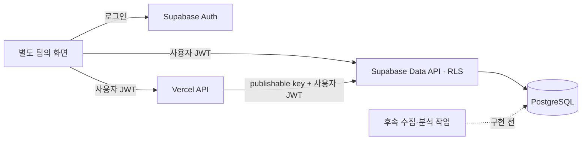

# 데이터베이스·배포 환경 준비

2026-11-11 기준. 사용자가 Supabase와 Vercel을 선택했고 화면 제작은 별도 팀이 맡는다. 이 문서는 [PRD](prd/01-product-prd.md)의 D-06·D-07을 위한 초기 구현 기록이다. 공고 수집·실거래 비교·PDF 추출·자금 계산의 완성을 뜻하지 않는다.

## 1. 준비 상태를 구분한다

| 대상을 확인한다 | 준비한 내용을 기록한다 | 실제 연결 상태를 구분한다 |
| --- | --- | --- |
| Supabase | PostgreSQL 마이그레이션, 계정 소유권·관계 제약, 행 수준 보안(RLS), 프로필 승인 함수 | 서울의 `homecierge-dev` 생성, 마이그레이션 2개 적용, 원격 권한·승인 검사 완료 |
| Vercel | 화면과 독립적인 TypeScript API, Node.js 26, 서울 `icn1`, 환경변수·배포 제외 설정 | `homecierge-api`의 보호된 Preview 배포 완료. Development/Preview에 DB URL·publishable key와 환경 구분 등록 |
| 화면 팀 인계 | 데이터 접근·프로필 승인·인증 API 계약과 환경변수 이름 | 화면 프레임워크·실제 origin·Auth 리다이렉트 URL 미정 |
| 검증 | 로컬 46개 검사, 실제 DB의 합성 역할 검사·롤백, 배포 HTTP 응답 확인 | 실제 가입·로그인·세션 갱신·Storage와 화면 통합 검수는 별도 |

사용자가 Supabase `95sionkim` 조직과 Vercel `sion's projects` 팀에 새 프로젝트를 생성하도록 선택했고, Supabase 추가 프로젝트 견적 월 US$0을 승인했다. 이 조건으로 생성했으며 요금제를 변경하지 않았다. 향후 사용량·요금 변경까지 월 US$0으로 보장하는 의미는 아니다. 기존 다른 프로젝트의 DB·환경변수는 사용하지 않았다.

- [Supabase 개발 프로젝트](https://supabase.com/dashboard/project/jcaelooqogosbzrfyrhe): 프로젝트 참조 `jcaelooqogosbzrfyrhe`, API URL `https://jcaelooqogosbzrfyrhe.supabase.co`.
- [Vercel API 프로젝트](https://vercel.com/sions-projects-d18fe574/homecierge-api): 프로젝트 ID `prj_DHDxRGbVUzvFTKThuMfw6ptkmbmK`. API 접속 주소는 [화면 팀 계약](frontend-handoff.md)에 기록한다.

## 2. 역할과 환경을 나눈다



사용자 요청의 Vercel API는 `service_role`로 RLS를 우회하지 않는다. 요청마다 Supabase 클라이언트를 생성하고 Auth 서버의 `getUser()`로 사용자를 확인한다. 수집·분석용 관리 권한, 외부 API 인증값, LLM 실행은 이번 API에 연결하지 않는다.

| 환경을 구분한다 | DB 연결을 정한다 | 배포·자료 사용 조건을 정한다 |
| --- | --- | --- |
| 로컬 | PGlite 합성 검사 또는 별도 로컬 Supabase | 합성 자료만 기본 사용. Docker가 없으면 전체 Supabase 로컬 스택은 실행할 수 없음 |
| Development / Preview | 생성한 `homecierge-dev` | 별도 개발 계정과 합성 자료. Production용 DB URL·키를 복사하지 않음 |
| Production | 별도 운영 Supabase를 연결하는 설계 | 이번에 운영 DB를 자동 생성하지 않음. 이용 조건·삭제·인증 설정 검수 후 별도 연결 |

Supabase는 서울 `ap-northeast-2`, API 실행 리전은 서울 `icn1`이다. Vercel 빌드 머신은 미국 `iad1`에서 실행됐으므로 빌드 위치와 함수 실행 위치를 구분한다. `APP_ENV`가 Production과 맞지 않으면 인증 API는 503으로 닫힌다. `health`의 200은 DB 연결 성공을 의미하지 않는다. Production 환경변수·운영 DB·운영 배포는 준비하지 않았다.

## 3. 저장 범위와 권한을 확인한다

| 테이블을 구분한다 | 저장할 내용을 정의한다 | 클라이언트 권한을 제한한다 |
| --- | --- | --- |
| `user_profiles` | 확인된 탐색 조건·출퇴근 목적지·수정 버전 | 자기 행 조회, 빈 프로필 최초 생성. 값 변경은 승인 함수만 |
| `profile_change_requests` | 변경안·기준 버전·근거·승인/거절/취소 | 자기 변경안 생성·조회, 명시적 판단 함수 호출 |
| `chats`, `chat_messages` | 계정별 대화·메시지 | 자기 대화 생성·제목 수정, 사용자 메시지 생성. assistant/system 생성 금지 |
| `analyses` | 한 분석의 공고·주택형·조건·규칙 버전·상태 | 자기 초안 생성·조회. 완료 상태는 서버 작업만 변경 |
| `funding_entries` | 분석별 보유/추가 자금·날짜·확정/예상 | 자기 분석에만 생성·수정·조회. 보유 자금은 분석당 한 행 |
| `reports` | 결과·조건·출처·미확인·조회 시점의 버전별 스냅샷 | 자기 결과 조회. 생성·수정은 서버 작업 전용 |
| `source_registry` | 저장·재사용·LLM·내보내기의 허용 상태 | 로그인 후 읽기. 기본은 `unknown`, 실제 출처 자료 없음 |
| `notices`, `notice_documents`, `housing_types` | 공고·문서 버전·면적 종류·출처 페이지 | 로그인 후 읽기. 수집·검수 서버만 기록 |
| `private.ingestion_runs` | 요청 범위·수집 상태·건수·시점 | Data API 비공개. 서버만 접근 |

공개 스키마의 모든 테이블에 RLS와 명시적 권한을 함께 적용했다. 다른 사용자의 대화나 분석을 자식 행에서 참조하지 못하도록 `(id, user_id)` 복합 외래 키를 사용한다. 익명 역할과 익명 로그인은 사용자 자료에 접근하지 못한다.

공유 프로필의 JSON 키는 탐색 조건과 목적지만 허용한다. 상세 자금이 들어가는 변경안은 거부한다. 프로필 승인에서는 현재 버전과 변경안의 `base_revision`을 비교하고, 충돌 시 기존 변경안을 자동 적용하지 않는다. 거절·취소·미응답은 프로필을 바꾸지 않는다. 권한을 가진 내부 함수는 비공개 스키마에서 인증·소유권을 확인하며, 공개 함수는 그 제한된 작업만 호출한다.

공급면적이 `verified`이면 공급면적 값·같은 공고의 문서·페이지가 필요하다. 이 제약은 출처의 실제 정확도나 추출 검증을 대신하지 않는다. 수집 `complete`도 건수·완료 시점의 정합성을 뜻하며 제품의 정상 0개 판정이 아니다. 가격·실거래 원문·PDF 객체·뉴스 원문·경로 원문은 이번 DB에 적재하지 않았다.

## 4. 삭제·Storage의 남은 계약을 명시한다

사용자 입력을 삭제할 때까지 보관하고 개별·계정 삭제를 지원한다는 R-12·A-56은 유지한다. 현재 기반에서는 Auth 사용자 삭제에 따른 관계형 데이터의 연쇄 삭제만 합성 검사했다. 계정 삭제 API·세션 철회·Storage 객체 정리·백업 처리·기존 보고서의 파생 개인정보 삭제는 아직 구현하지 않았다.

이 작업이 원자적으로 처리되기 전에는 클라이언트의 직접 DELETE 권한을 열지 않는다. 화면 팀도 삭제 완료 기능을 구현된 것으로 표시하면 안 된다. 계획된 관계형 삭제 영향은 대화→메시지/분석→자금/보고서이며, 개별 자금·메시지와 파생 보고서의 처리 방식은 D-06에서 보완한다. 원격 계정 삭제를 시험하는 스크립트는 기본 검사에 넣지 않는다.

PDF 업로드와 보고서 PDF의 Storage 버킷·정책은 자료 이용·보관 조건 및 삭제 작업을 함께 정한 뒤 추가한다. 파일을 공개 버킷이나 Vercel 정적 디렉터리에 저장하지 않는다. 현재는 Storage 버킷·업로드 API가 없다.

## 5. 재현 가능한 로컬 검사를 실행한다

```sh
npm ci
npm run build
npm test
npm run test:db
python3 -m unittest discover -s scripts -p 'test_*.py' -v
python3 scripts/check_repository.py
```

Node.js 버전은 [.nvmrc](../.nvmrc), 라이브러리와 CLI는 [package.json](../package.json)·[package-lock.json](../package-lock.json)으로 고정한다. DB 검사는 메모리 내 PostgreSQL(PGlite)에 합성 Auth 역할을 만들며, 원격 프로젝트·Docker·실제 인증값이 필요 없다. 기존 Python 조회 도구의 리뷰 결함은 이번 인프라 작업에서 수정하지 않았다.

2026-11-11 검사에서 TypeScript 빌드, DB 12개·API 8개·기존 Python 26개 테스트가 통과했다. 저장소 기본 검사와 변경·추가 파일의 JSON/TOML·내부 문서 링크 검사도 통과했으며 `npm audit`의 보고된 취약점은 0개였다. 기본 검사는 실제 Supabase Auth 흐름의 통합 검수가 아니다.

Supabase CLI 3.1.0으로 설정과 두 마이그레이션 파일을 만들고, 연결 도구로 원격 DB에 적용했다. 파일의 버전은 실제 원격 이력과 맞췄다: `20261111041123_foundation`, `20261111041247_explicit_policy_execution`. CLI v3는 DB 작업의 기본 대상이 로컬이므로 원격 작업 시 대상과 도움말을 먼저 확인한다. 이미 적용된 파일을 수정하거나 다시 적용하지 않고 새 마이그레이션을 추가한다.

원격 적용 뒤 [수동 SQL 검사](../supabase/tests/remote-smoke.sql)에서 계정 간 조회·쓰기와 교차 소유 참조 차단, 직접 프로필 수정 차단, 명시적 승인·중복 승인 차단, 익명 접근 차단을 확인했다. 합성 사용자는 롤백으로 제거했고 Auth 사용자·프로필·대화·변경안이 0행임을 확인했다. 이는 실제 Auth 가입·토큰 발급 검사가 아니다.

Supabase 보안 advisors에는 항목이 없었고, 성능 advisors에는 아직 사용하지 않은 인덱스 16개의 INFO만 있었다. 새 빈 DB의 인덱스를 삭제하지 않았으며 실제 쿼리·사용량이 생긴 뒤 재검토한다. [Unused Index 안내](https://supabase.com/docs/guides/database/database-linter?lint=0005_unused_index)

원격 스키마에서 생성한 [Database 타입](../src/db/database.types.ts)을 API 클라이언트에 적용했다. 이후 마이그레이션을 적용하면 Supabase의 타입 생성 도구로 다시 생성하고 빌드·권한 검사를 실행한다. `supabase/config.toml`은 로컬 개발 설정이며 호스팅 Auth 설정을 변경한 증거로 사용하지 않는다.

Vercel Preview는 `READY`와 오류 없는 최종 빌드 로그를 확인했다. 실제 HTTP 응답은 생존 확인 200, 미로그인·잘못된 토큰 401, 없는 경로 404였다. 배포 보호를 유지한 브라우저에서 본문까지 확인했다. 로그인한 실제 사용자의 `/api/ready` 200과 전체 Auth·화면 통합은 후속 검수다. 첫 호출의 기본 target이 Production으로 잡힌 배포는 삭제했으며 이후 REST 요청은 `target: staging`을 명시해 대시보드의 Preview 환경임을 확인했다.

## 6. 연결할 환경변수를 구분한다

| 이름을 확인한다 | 설정 위치를 정한다 | 사용 목적을 설명한다 |
| --- | --- | --- |
| `SUPABASE_URL` | `.secrets/backend.env` 또는 Vercel의 해당 환경 | 선택한 프로젝트의 API URL |
| `SUPABASE_PUBLISHABLE_KEY` | `.secrets/backend.env` 또는 Vercel의 해당 환경 | 새 publishable key. 값은 문서·Git·출력에 남기지 않음 |
| `APP_ENV` | 해당 환경 | `development`, `preview`, `production` 중 실제 환경 |
| `ALLOWED_ORIGINS` | 해당 환경 | 화면 origin의 정확한 목록을 쉼표로 구분. 전체 와일드카드 금지 |

Preview/Development에 위 네 변수를 등록했고 publishable key는 Vercel에서 암호화해 저장했다. Production에는 등록하지 않았다. 현재 허용 origin은 `localhost`·`127.0.0.1`의 3000·5173 포트다. 화면 팀은 프레임워크에 맞는 공개 환경변수 이름을 별도로 사용하며 관리 키를 넣지 않는다. 실제 화면 도메인이 정해진 뒤 Supabase Auth의 Site URL·리다이렉트 허용 목록과 API origin 목록을 함께 맞춘다.

로컬은 `.env.example`의 API 연결 항목을 Git에서 제외된 `.secrets/backend.env`에 복사한 뒤 값을 채워 `npm run dev`로 실행한다. API 주소는 `http://127.0.0.1:3001`이며 `APP_ENV=development`를 사용한다. 비어 있는 값은 정상 연결로 간주하지 않는다. 현재 로컬 인증값 파일은 자동으로 생성하지 않았다.

Vercel 정적 출력은 `public/`로 제한하고 [.vercelignore](../.vercelignore)에서 비공개 증거·문서·로컬 인증 파일을 제외한다. 화면 팀의 결과물을 이 API 프로젝트에 합치는 것은 후속 통합 작업이며, 현재 별도 화면 배포에서도 호출할 수 있는 구조다.

이번 Preview 배포는 허용한 소스 파일을 직접 업로드했다. 인프라 코드는 이 저장소에서 관리하며 Vercel의 Git 자동 배포는 아직 연결하지 않았다. 자동 배포 연결은 저장소·브랜치와 환경 구분을 확인한 뒤 별도로 진행한다. Preview의 Vercel 배포 보호는 CORS·Supabase 로그인과 별개다. 별도 화면에서의 교차 출처 호출은 로컬 API로 먼저 검수하고, 보호된 Preview 접근 방식은 화면 배포 시 함께 연결한다. 보호 우회 값을 브라우저 코드에 넣지 않는다.

## 7. 공식 문서를 확인한다

- [Supabase RLS와 테이블 권한](https://supabase.com/docs/guides/database/postgres/row-level-security): 권한과 행 단위 소유권을 함께 적용한다.
- [Supabase CLI v3 변경 사항](https://supabase.com/changelog/supabase-cli-v3): 원격 대상·설정 우선순위·명령 형식이 변경됐다.
- [Vercel Node.js Functions](https://vercel.com/docs/functions/runtimes/node-js): 공유 API 진입점과 Web Request/Response를 사용한다.
- [Vercel Node.js 지원 버전](https://vercel.com/docs/functions/runtimes/node-js/node-js-versions): 이번 준비의 Node.js 26 지원을 확인했다.
