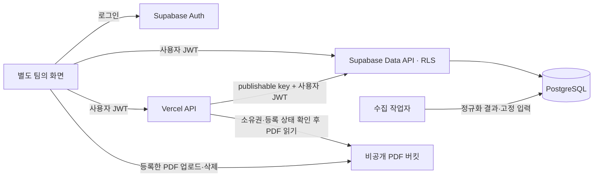

# 데이터베이스·배포 환경 준비

2026-11-22 기준. 사용자가 Supabase와 Vercel을 선택했고 화면 제작은 별도 팀이 맡는다. 이 문서는 [PRD](prd/01-product-prd.md)의 D-06·D-07 관련 개발 환경과 현재 연결 범위를 기록한다.

## 1. 준비 상태를 구분한다

| 대상을 확인한다 | 준비한 내용을 기록한다 | 실제 연결 상태를 구분한다 |
| --- | --- | --- |
| Supabase | 계정 소유권·행 수준 보안(RLS), 프로필 승인, 분석별 수집 결과·비공개 파일 | 서울의 `homecierge-dev` 사용. 적용 이력과 검사 환경은 아래에 기록 |
| Vercel | 화면과 독립적인 TypeScript API, Node.js 26, 서울 `icn1`, 환경변수·배포 제외 설정 | `homecierge-api`의 보호된 Preview 배포 완료. Development/Preview에 DB URL·publishable key와 환경 구분 등록 |
| 화면 팀 인계 | 데이터 접근·프로필 승인·인증 API 계약과 환경변수 이름 | 화면 프레임워크·실제 origin·Auth 리다이렉트 URL 미정 |
| 검증 | 기본 검사와 실제 Auth·Storage를 호출하는 개발 통합 검사 | 출시 로그인 제공자·화면 리다이렉트·보호된 Preview에서의 사용자 여정은 화면 인계 후 검수 |

사용자가 Supabase `95sionkim` 조직과 Vercel `sion's projects` 팀에 새 프로젝트를 생성하도록 선택했고, Supabase 추가 프로젝트 견적 월 US$0을 승인했다. 이 조건으로 생성했으며 요금제를 변경하지 않았다. 향후 사용량·요금 변경까지 월 US$0으로 보장하는 의미는 아니다. 기존 다른 프로젝트의 DB·환경변수는 사용하지 않았다.

- [Supabase 개발 프로젝트](https://supabase.com/dashboard/project/jcaelooqogosbzrfyrhe): 프로젝트 참조 `jcaelooqogosbzrfyrhe`, API URL `https://jcaelooqogosbzrfyrhe.supabase.co`.
- [Vercel API 프로젝트](https://vercel.com/sions-projects-d18fe574/homecierge-api): 프로젝트 ID `prj_DHDxRGbVUzvFTKThuMfw6ptkmbmK`. API 접속 주소는 [화면 팀 계약](frontend-handoff.md)에 기록한다.

## 2. 역할과 환경을 나눈다



사용자 요청의 Vercel API는 `service_role`로 RLS를 우회하지 않는다. 요청마다 Supabase 클라이언트를 생성하고 Auth 서버의 `getUser()`로 사용자를 확인한다. 수집·분석용 관리 권한, 외부 API 인증값, LLM 실행은 이번 API에 연결하지 않는다.

| 환경을 구분한다 | DB 연결을 정한다 | 배포·자료 사용 조건을 정한다 |
| --- | --- | --- |
| 로컬 | PGlite 합성 검사 또는 별도 로컬 Supabase | 합성 자료만 기본 사용. Docker가 없으면 전체 Supabase 로컬 스택은 실행할 수 없음 |
| Development / Preview | 생성한 `homecierge-dev` | 별도 개발 계정·합성 검사 자료. 공고 탐색에는 이용 조건을 확인한 청약홈 구조화 목록과 현존 지역코드를 게시 |
| Production | 별도 운영 Supabase를 연결하는 설계 | 이번에 운영 DB를 자동 생성하지 않음. 이용 조건·삭제·인증 설정 검수 후 별도 연결 |

Supabase는 서울 `ap-northeast-2`, API 실행 리전은 서울 `icn1`이다. Vercel 빌드 머신은 미국 `iad1`에서 실행됐으므로 빌드 위치와 함수 실행 위치를 구분한다. `APP_ENV`가 Production과 맞지 않으면 인증 API는 503으로 닫힌다. `health`의 200은 DB 연결 성공을 의미하지 않는다. Production 환경변수·운영 DB·운영 배포는 준비하지 않았다.

## 3. 저장 범위와 권한을 확인한다

| 테이블을 구분한다 | 저장할 내용을 정의한다 | 클라이언트 권한을 제한한다 |
| --- | --- | --- |
| `user_profiles` | 확인된 탐색 조건·출퇴근 목적지·수정 버전 | 자기 행 조회, 빈 프로필 최초 생성. 값 변경은 승인 함수만 |
| `profile_change_requests` | 변경안·기준 버전·근거·승인/거절/취소 | 자기 변경안 생성·조회, 명시적 판단 함수 호출 |
| `chats`, `chat_messages` | 계정별 대화·메시지 | 자기 대화 생성·제목 수정, 사용자 메시지 생성. assistant/system 생성 금지 |
| `analyses` | 한 분석의 공고·주택형·조건·규칙 버전·상태 | 자기 초안 생성·조회. 완료 상태는 서버 작업만 변경 |
| `funding_entries` | 분석별 보유/추가 자금·날짜·확정/예상 | 자기 분석에만 생성·수정·조회. 보유 자금은 분석당 한 행 |
| `private.analysis_funding_schedule_snapshots` | 공고 수집본에 고정한 호실·항목별 납부 근거 | 작업자가 수집본과 함께 저장한다. 인증된 소유자는 출처 권한과 호실을 대조한 RPC를 통해 조회한다. |
| `reports` | 결과·조건·출처·미확인·조회 시점의 버전별 스냅샷 | 자기 결과 조회. 생성·수정은 서버 작업 전용 |
| `source_registry` | 저장·재사용·화면 표시·LLM·내보내기의 허용 상태 | 로그인 후 읽기. 허용 상태의 기본값은 `unknown` |
| `notices`, `notice_documents`, `housing_types` | 공고·문서 버전·면적 종류·출처 페이지 | 로그인 후 읽기. 수집·검수 서버만 기록 |
| 실행 기록과 대기열 | 접수 때 고정한 분석 입력, 시도·임대·상태, 준비한 수집본 참조 | 소유자는 접수·조회·취소 함수를 사용하고 작업자는 임대 유효 기간에 결과를 기록 |
| `private.ingestion_runs` | 요청 범위·수집 상태·건수·시점 | Data API 비공개. 서버만 접근 |
| `analysis_input_snapshots`와 수집 조회 뷰 | 분석 시점의 입력·규칙, 공고·문서 버전, 페이지·거래 관측 | 서버 작업자가 저장하고 소유자만 조회 |
| `private.comparison_evidence`, `private.comparison_results` | 수집본에 대조한 단지·면적 근거와 실행별 비교 결과 | 서버가 근거를 등록하고 결과를 저장. 사용자는 자기 분석과 실행을 지정해 결과를 조회 |
| `analysis_uploads`와 비공개 `analysis-uploads` 버킷 | 사용자·분석에 귀속된 PDF 등록, 업로드와 삭제 상태 | 로그인한 소유자만 등록·업로드·읽기·삭제 |

공개 스키마의 모든 테이블에 RLS와 명시적 권한을 함께 적용했다. 다른 사용자의 대화나 분석을 자식 행에서 참조하지 못하도록 `(id, user_id)` 복합 외래 키를 사용한다. 익명 역할과 익명 로그인은 사용자 자료에 접근하지 못한다.

공유 프로필의 JSON 키는 탐색 조건과 목적지만 허용한다. 상세 자금이 들어가는 변경안은 거부한다. 프로필 승인에서는 현재 버전과 변경안의 `base_revision`을 비교하고, 충돌 시 기존 변경안을 자동 적용하지 않는다. 거절·취소·미응답은 프로필을 바꾸지 않는다. 권한을 가진 내부 함수는 비공개 스키마에서 인증·소유권을 확인하며, 공개 함수는 그 제한된 작업만 호출한다.

공급면적이 `verified`이면 공급면적 값·같은 공고의 문서·페이지가 필요하다. 이 제약은 출처의 실제 정확도나 추출 검증을 대신하지 않는다. 수집 `complete`도 건수·완료 시점의 정합성을 뜻하며 제품의 정상 0개 판정이 아니다. 가격·실거래 원문·PDF 객체·뉴스 원문·경로 원문은 이번 DB에 적재하지 않았다.

## 4. 삭제·Storage의 남은 계약을 명시한다

사용자 입력을 삭제할 때까지 보관하고 개별·계정 삭제를 지원한다는 R-12·A-56은 유지한다. 업로드 한 건은 삭제를 요청한 뒤 Storage API로 객체를 제거하고 등록을 마무리한다. 파일을 보유한 분석·계정은 파일 정리를 먼저 마친다. 사용자용 계정 삭제 API, 세션 철회, 백업과 파생 보고서 처리는 후속 작업이다.

이 작업이 원자적으로 처리되기 전에는 클라이언트의 직접 DELETE 권한을 열지 않는다. 화면 팀도 삭제 완료 기능을 구현된 것으로 표시하면 안 된다. 계획된 관계형 삭제 영향은 대화→메시지/분석→자금/보고서이며, 개별 자금·메시지와 파생 보고서의 처리 방식은 D-06에서 보완한다. 원격 계정 삭제를 시험하는 스크립트는 기본 검사에 넣지 않는다.

공고 PDF는 계정별 비공개 버킷에 업로드한다. 파일의 공식성·정정 회차·내용 판정과 보고서 PDF 생성은 별도 단계다. [저장·업로드 호출 순서](api/ingestion-storage.md)

## 5. 재현 가능한 로컬 검사를 실행한다

```sh
npm ci
npm run build
npm test
npm run test:db
python3 -m unittest discover -s scripts -p 'test_*.py' -v
python3 scripts/check_repository.py
```

Node.js 버전은 [.nvmrc](../.nvmrc), 라이브러리와 CLI는 [package.json](../package.json)·[package-lock.json](../package-lock.json)으로 고정한다. 기본 DB 검사는 메모리 내 PostgreSQL(PGlite)에 합성 Auth·Storage를 구성한다.

실제 인증 통합 검사는 `npm run test:auth`로 실행한다. 격리된 Supabase의 `SUPABASE_URL`·`SUPABASE_PUBLISHABLE_KEY`·`SUPABASE_WORKER_KEY`를 해당 프로세스에만 주입한다. 지정한 서울 개발 프로젝트에서는 `APP_ENV=development`도 필요하다. 검사는 임시 계정 두 개를 만들고 로그인·토큰 갱신·소유권·파일 정리를 확인한다. GitHub Actions에서는 작업마다 새 로컬 Supabase를 시작해 같은 검사를 실행한다. [통합 검사 정의](../.github/workflows/supabase-integration.yml)

2026-11-21에 개발 DB에 BE-03 마이그레이션 네 개를 추가하고, 기존 두 개를 포함한 여섯 파일의 버전을 원격 이력에 맞췄다. 서울 개발 DB에서 다시 생성한 TypeScript 타입과 저장소 파일이 일치한다. [마이그레이션](../supabase/migrations) · [생성 타입](../src/db/database.types.ts)

두 임시 계정으로 실제 로그인·세션 갱신·재로그인을 거쳤다. 첫 계정에서는 Python CLI로 저장했고, 둘째 계정에서는 같은 수집 키의 병행 저장이 한 ID를 반환했다. 두 계정 모두 자신의 스냅샷과 근거만 읽었다. 같은 다운로드 API 주소로 본인 PDF를 두 번 수신했고, 타인·삭제 요청 직후·삭제 완료 후 재로그인에서는 404를 확인했다. 로컬 HTTP 서버에서도 같은 검사를 통과했다. 시험 종료 후 개발 DB의 Auth 사용자·분석·스냅샷·등록 파일·Storage 객체는 각각 0건이었다.

같은 날 서울 개발 DB에 [BE-04 실행 마이그레이션](../supabase/migrations/20261121021223_analysis_execution.sql)을 적용하고 타입을 다시 생성했다. 개발 HTTP 서버, Python 작업자, 실제 Supabase Auth·PostgREST·Storage를 연결해 두 계정으로 실행을 접수했다. 중복 접수는 같은 실행을 반환했고, 중단된 작업은 다음 작업자가 인수했다. 완료와 취소가 겹쳐도 종료 상태와 수집본 수가 일치했다. 새 세션에서는 본인의 `analyses.latest_run_id`로 실행과 수집본을 다시 열었다. 검사 후 사용자·프로필·대화·분석·실행·수집본·등록 파일·업로드 객체가 모두 0건임을 확인했다. [실행 API 계약](api/analysis-runs.md)

별도 PostgreSQL 17.12에서 한 계정으로 16개 분석을 동시에 접수해 개발 한도인 12개 접수와 4개 제한을 확인했다. 같은 요청 10개는 실행 하나를 만들었고 작업자 5개 중 하나만 그 실행을 인수했다. 개발 DB의 보안 점검에는 비공개 실행 테이블의 기본 접근 차단(INFO)과 Auth의 유출 비밀번호 검사 설정(WARN)이 표시됐다. 출시 로그인 설정은 D-06에서 검수한다.

2026-11-11 기초 검사에서는 TypeScript 빌드와 DB 12개·API 8개·Python 26개 테스트가 통과했다. 저장소 구성·문서 링크와 배포 응답도 확인했다.

11월 11일에는 Supabase CLI 3.1.0으로 설정과 두 마이그레이션 파일을 만들고, 연결 도구로 원격 DB에 적용했다. 파일의 버전은 실제 원격 이력과 맞췄다: `20261111041123_foundation`, `20261111041247_explicit_policy_execution`. CLI v3는 DB 작업의 기본 대상이 로컬이므로 원격 작업 시 대상과 도움말을 먼저 확인한다. 이미 적용된 파일을 수정하거나 다시 적용하지 않고 새 마이그레이션을 추가한다.

원격 적용 뒤 [수동 SQL 검사](../supabase/tests/remote-smoke.sql)에서 계정 간 조회·쓰기와 교차 소유 참조 차단, 직접 프로필 수정 차단, 명시적 승인·중복 승인 차단, 익명 접근 차단을 확인했다. 합성 사용자는 롤백으로 제거했고 Auth 사용자·프로필·대화·변경안이 0행임을 확인했다. 이는 실제 Auth 가입·토큰 발급 검사가 아니다.

11월 11일 Supabase 보안 advisors에는 항목이 없었고, 성능 advisors에는 아직 사용하지 않은 인덱스 16개의 INFO만 있었다. 새 빈 DB의 인덱스를 삭제하지 않았으며 실제 쿼리·사용량이 생긴 뒤 재검토한다. [Unused Index 안내](https://supabase.com/docs/guides/database/database-linter?lint=0005_unused_index)

원격 스키마에서 생성한 [Database 타입](../src/db/database.types.ts)을 API 클라이언트에 적용했다. 이후 마이그레이션을 적용하면 Supabase의 타입 생성 도구로 다시 생성하고 빌드·권한 검사를 실행한다. `supabase/config.toml`은 로컬 개발 설정이며 호스팅 Auth 설정을 변경한 증거로 사용하지 않는다.

11월 11일 Vercel Preview는 `READY`와 오류 없는 최종 빌드 로그를 확인했다. 실제 HTTP 응답은 생존 확인 200, 미로그인·잘못된 토큰 401, 없는 경로 404였다. 배포 보호를 유지한 브라우저에서 본문까지 확인했다. 첫 호출의 기본 target이 Production으로 잡힌 배포는 삭제했으며 이후 REST 요청은 `target: staging`을 명시해 대시보드의 Preview 환경임을 확인했다.

11월 21일 `codex/backend-foundation`의 `8843026`으로 보호된 Preview를 배포해 `READY`를 확인했다. `/api/health`는 200, 서비스 로그인 없이 실행을 조회한 요청은 401 `authentication_required`, 접수 주소에 보낸 GET은 405와 `Allow: POST, OPTIONS`를 반환했다. 두 계정의 로그인부터 작업자 완료까지는 서울 개발 DB와 GitHub Actions의 격리 Supabase에서 각각 검수했다. 화면 도메인·로그인까지 이어지는 검수는 화면 인계 후 진행한다. [Preview 주소](frontend-handoff.md) · [Supabase 통합 검사](https://github.com/95sionkim/HomeCierge/actions/runs/44854748617) · [기본 검사](https://github.com/95sionkim/HomeCierge/actions/runs/44854748670)

서울 개발 DB에 [BE-05 비교 결과 마이그레이션](../supabase/migrations/20261121024901_comparison_results.sql)을 적용하고 DB 타입을 다시 생성했다. 두 시험 계정으로 합성 공고를 비교해 주변 2단지의 종류별 가격을 조회하고, 같은 수집본 재실행 및 재로그인 뒤 결과의 일치를 확인했다. 다른 계정의 조회는 404였고 독립적으로 저장된 수집본에는 데모 근거가 적용되지 않았다. 검사 후 계정·실행·수집본·비교 결과·비공개 업로드의 잔여 건수는 각각 0이었다. [비교 결과 계약](api/comparison-v1.md)

BE-05 구현 커밋 `cad297e`의 보호된 Preview는 `READY`를 확인했다. 배포 보호가 적용된 주소는 팀 세션 없이 접근하면 302, 팀 세션으로 접근한 생존 확인은 200, Supabase 사용자 세션 없이 요청한 비교 결과는 401이었다. 마이그레이션을 처음부터 적용한 GitHub Actions의 격리 Supabase에서도 두 사용자 검사가 통과했다. [화면 팀 Preview 주소](frontend-handoff.md) · [Supabase 통합 검사](https://github.com/95sionkim/HomeCierge/actions/runs/44858258513) · [기본 검사](https://github.com/95sionkim/HomeCierge/actions/runs/44858258476)

2026-11-22에 서울 개발 DB에 [공고 탐색 색인 마이그레이션](../supabase/migrations/20261122044154_notice_search_index.sql)을 적용하고 사용자·작업자 RPC 타입을 다시 생성했다. 가입 확인을 마친 사용자의 DB 역할로 조회하는 롤백 검사에서 공고 83건과 현존 지역코드 269개가 반환됐다. 익명 역할은 읽을 수 없고 일반 사용자는 게시할 수 없었다. 출처 이용 조건을 확인한 두 공고 목록과 지역코드 세 출처만 등록했다. PDF를 포함한 호실 자료의 공유 게시에는 별도 출처 검수가 필요하다. [게시 범위와 수동 갱신 절차](api/notice-search.md)

같은 커밋의 보호된 Vercel Preview는 `READY`였다. 팀 접근 없이 302, 보호를 통과한 `/api/health`는 200, 검색 주소의 GET은 405와 POST 허용 헤더를 확인했다. GitHub Actions가 새로 설치한 Supabase에서는 두 사용자가 로그인해 같은 공유 공고를 검색했고, 예산 1원 차이, 동시 게시 충돌, 일반 사용자의 게시 거부와 출처 표시 권한 철회를 확인했다. 합성 출처 권한 변경은 작업이 끝나면 폐기하는 이 로컬 스택에서 수행했다. [화면 팀 Preview 주소](frontend-handoff.md) · [Supabase 통합 검사](https://github.com/95sionkim/HomeCierge/actions/runs/44986319057) · [기본 검사](https://github.com/95sionkim/HomeCierge/actions/runs/44986319064)

서울 개발 DB의 [자금표 마이그레이션](../supabase/migrations/20261122052921_analysis_funding_plan.sql)을 적용하고 공개 RPC 타입을 생성했다. 합성 자료를 쓴 롤백 검사에서 같은 수집 키의 재시도, 소유자 조회, 큰 원 단위 정수의 보존, 자금 수정 반영, 다른 사용자의 조회 거부를 확인했다. 현재 `applyhome_apt_model`, `applyhome_remainder_model`, `applyhome_notice_pdf`에는 공고 목록과 같은 저장·재사용·표시 허용 기록이 없어, 해당 자료에서 파생한 일정을 지속적으로 제공하려면 출처별 검수가 필요하다. [자금표 계약](api/funding-plan.md)

구현 커밋 `e2c916a`는 개발 브랜치 Preview에서 `READY`였다. GitHub Actions의 격리 Supabase에서는 소유자가 Auth로 로그인해 선택한 호실 일정을 읽고 자금을 수정해 부족액을 다시 계산했다. 다른 계정이 같은 분석을 조회하면 404가 반환됐다. 날짜가 미정인 납부와 서로 다른 정정판의 호실 충돌은 합성 PDF부터 데이터베이스와 계산 응답까지 검수했다. [Supabase 통합 검사](https://github.com/95sionkim/HomeCierge/actions/runs/44989806440) · [기본 검사](https://github.com/95sionkim/HomeCierge/actions/runs/44989806473)

BE-09에서 서울 개발 DB에 [법령 참조 마이그레이션](../supabase/migrations/20261122055129_analysis_legal_evidence.sql)을 적용하고 타입을 다시 생성했다. 청약홈 APT·무순위 주택형의 구조화 자료와 법제처의 판본·조문 표지는 출처 확인 뒤 개발 레지스트리에 저장·재사용·표시 허용으로 등록했다. 청약홈 공고 PDF와 PDF에서만 얻은 호실별 납부 일정의 재사용 권리는 별도 확인이 남아 있다. 6월·9월 실제 공고의 법령은 각 공고일에 해당하는 서로 다른 시행본으로 등록됐다. [법령 조회와 검산](api/legal-evidence.md) · [출처별 이용 근거](api/be-09-source-evidence.md)

## 6. 연결할 환경변수를 구분한다

| 이름을 확인한다 | 설정 위치를 정한다 | 사용 목적을 설명한다 |
| --- | --- | --- |
| `SUPABASE_URL` | `.secrets/backend.env` 또는 Vercel의 해당 환경 | 선택한 프로젝트의 API URL |
| `SUPABASE_PUBLISHABLE_KEY` | `.secrets/backend.env` 또는 Vercel의 해당 환경 | 새 publishable key. 값은 문서·Git·출력에 남기지 않음 |
| `APP_ENV` | 해당 환경 | `development`, `preview`, `production` 중 실제 환경 |
| `ALLOWED_ORIGINS` | 해당 환경 | 화면 origin의 정확한 목록을 쉼표로 구분. 전체 와일드카드 금지 |
| `SUPABASE_WORKER_KEY` | 수집 작업자 또는 격리된 통합 검사 프로세스 | 서버 전용 저장 및 시험 계정 관리에 사용 |

Preview/Development에 사용자 API용 네 변수를 등록했고 publishable key는 Vercel에서 암호화해 저장했다. Production에는 등록하지 않았다. 현재 허용 origin은 `localhost`·`127.0.0.1`의 3000·5173 포트다. 화면 팀은 프레임워크에 맞는 공개 환경변수 이름을 별도로 사용하며 관리 키를 넣지 않는다. 실제 화면 도메인이 정해진 뒤 Supabase Auth의 Site URL·리다이렉트 허용 목록과 API origin 목록을 함께 맞춘다.

로컬은 `.env.example`의 API 연결 항목을 Git에서 제외된 `.secrets/backend.env`에 복사한 뒤 값을 채워 `npm run dev`로 실행한다. API 주소는 `http://127.0.0.1:3001`이며 `APP_ENV=development`를 사용한다. 비어 있는 값은 정상 연결로 간주하지 않는다. 현재 로컬 인증값 파일은 자동으로 생성하지 않았다.

Vercel 정적 출력은 `public/`로 제한하고 [.vercelignore](../.vercelignore)에서 비공개 증거·문서·로컬 인증 파일을 제외한다. 화면 팀의 결과물을 이 API 프로젝트에 합치는 것은 후속 통합 작업이며, 현재 별도 화면 배포에서도 호출할 수 있는 구조다.

초기 Preview는 소스 파일을 직접 업로드했다. 11월 22일 Vercel 배포 이력에서는 개발 브랜치 커밋 `eeb2b62`가 Preview로, PR #1의 `main` 병합 커밋 `4a778c3`가 Production으로 자동 배포돼 각각 `READY`에 도달했다. 두 브랜치의 배포 대상은 다르다. Preview의 Vercel 배포 보호와 Supabase 사용자 인증은 각각 확인한다. 별도 화면의 교차 출처 호출은 로컬 API에서 먼저 검수한다. [PR #1 병합 기록](https://github.com/95sionkim/HomeCierge/pull/1) · [Vercel 배포 이력](https://vercel.com/sions-projects-d18fe574/homecierge-api/deployments)

## 7. 공식 문서를 확인한다

- [Supabase RLS와 테이블 권한](https://supabase.com/docs/guides/database/postgres/row-level-security): 권한과 행 단위 소유권을 함께 적용한다.
- [Supabase CLI v3 변경 사항](https://supabase.com/changelog/supabase-cli-v3): 원격 대상·설정 우선순위·명령 형식이 변경됐다.
- [Vercel Node.js Functions](https://vercel.com/docs/functions/runtimes/node-js): 공유 API 진입점과 Web Request/Response를 사용한다.
- [Vercel Node.js 지원 버전](https://vercel.com/docs/functions/runtimes/node-js/node-js-versions): 이번 준비의 Node.js 26 지원을 확인했다.
