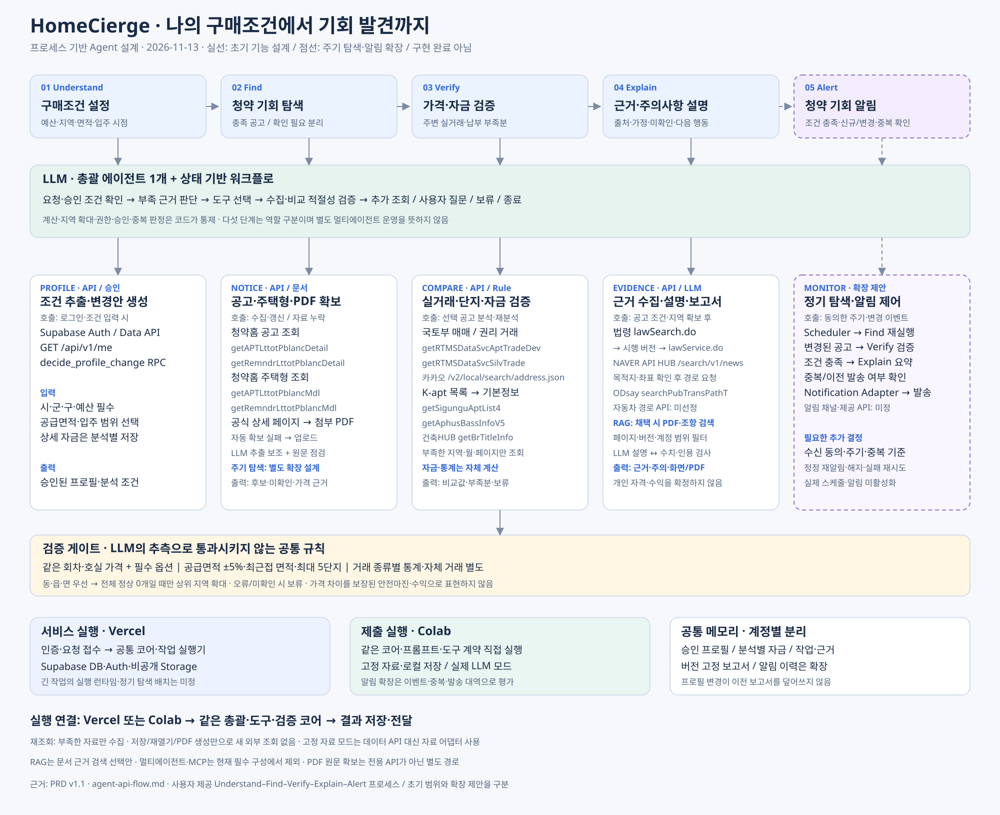

# HomeCierge 프로세스 기반 Agent 구성도

2026-11-13 · 사용자 제공 Understand → Find → Verify → Explain → Alert 흐름을 반영한 설계안

[SVG 원본](diagrams/process-agent-architecture.svg) · [API 14개 상세 계약](agent-api-flow.md) · [기존 전체 구조](agent-architecture.md)

## 1. 구조와 책임

**총괄 LLM 에이전트 1개가 다섯 단계의 작업을 조정하고, 도구와 검증 코드가 데이터를 조회·계산·판정한다.** 다섯 단계는 사용자 프로세스와 기능 역할이며 독립적인 에이전트 5개를 뜻하지 않는다. 사용자 입력부터 최종 설명까지 조건·근거·미확인 상태를 유지한다.

| 단계 | 에이전트 판단 | 도구·API와 호출 시점 | 결과 |
| --- | --- | --- | --- |
| Understand | 필요한 조건이 있는가? 이번 분석 변경인가, 공유 프로필 변경인가? | 로그인 시 Supabase Auth와 GET /api/v1/me. 자기 자료는 JWT·RLS를 적용한 Data API. 명시적 프로필 결정 시 decide_profile_change RPC | 승인된 구매조건·분석별 자금·변경안 |
| Find | 조건을 만족하는 주택형·호실이 확인됐는가? 가격/옵션 근거가 부족한가? | 공통 수집/갱신 또는 누락 시 청약홈 공고 2종·모델 2종 조회. 공식 상세 페이지에서 PDF 확보, 실패 시 업로드. 상세 엔드포인트는 API 문서 참조 | 충족 공고·확인 필요·미수집 범위·원문 근거 |
| Verify | 비교 가능한 거래·공식 공급면적·단지 식별이 확보됐는가? 납부 시점 자금이 충분한가? | 단일 공고·주택형 분석 시 국토부 매매/권리 거래의 필요한 지역·월·페이지 수집. 카카오·K-apt 목록/기본·대장으로 필요한 후보 보완. 통계·자금은 코드 계산 | 최대 5단지·종류별 통계·자체 거래·납부 부족분·보류 |
| Explain | 근거가 주장을 뒷받침하는가? 어떤 가정·주의·보완 행동을 전달할 것인가? | 공고 조건·지역 확보 후 법령 검색→시행 버전 본문, NAVER 뉴스. 목적지·좌표 확인 후 ODsay. RAG 채택 시 허용 문서 검색. LLM 설명을 결과와 대조 | 출처·페이지/조항·조건·시점·미확인이 일치하는 설명·화면·PDF |
| Alert — 확장 설계 | 새/변경 공고가 승인 조건을 만족하며 아직 알리지 않은 기회인가? | 동의한 주기/변경 이벤트에 Scheduler→Find→필요한 Verify→Explain. 중복 검사 후 Notification Adapter. 채널·발송 API·주기 미정 | 신규 기회 알림·발송 상태·변경 근거 |

UI·사용자 선택 흐름과 백그라운드 자료 준비를 구분한다. 법령·뉴스는 비교 완료를 기다리지 않아도 되고 자금·경로는 필요한 입력이 없으면 입력 필요 상태로 남기며 독립 결과를 제공한다.

## 2. 판단·실행 루프

요청/프로필 확인 → 부족 근거 산출 → 허용된 도구 선택 → 구조화 결과 반환 → 코드 검증 → 추가 조회·사용자 질문·보류·종료 → 근거 있는 설명.

호출은 해당 기능의 필요 조건이 갖춰졌을 때만 한다. 미확인을 0원·0분·정상 0개로 바꾸지 않는다. 전체 정상 0개에서만 기본 지역 확대를 자동 수행하고, 다른 지역·기간·면적 변경과 단지 교체는 확인을 거친다. 재시도·호출 상한·비용 정책은 상세 구현 시 확정한다.

## 3. 지속 탐색·알림의 범위와 추가 설계

첨부 프로세스의 지속 탐색과 Alert는 **목표 사용자 경험으로 반영**했다. 기존 PRD는 선제 알림을 후속 범위로 두므로 이번 구성도에서는 점선으로 표시한다. 실제 자동화 생성·주기 조회·발송을 활성화한 것은 아니다. 초기 출시 범위로 채택하려면 PRD와 수락 기준을 함께 갱신한다.

권고 실행 흐름은 다음과 같다.

1. 사용자가 알림 받을 구매조건·수신 채널·주기에 동의한다. 공유 프로필 저장과 알림 수신 동의는 별개다.
2. 수집 작업이 허용된 공고의 신규·정정·변경을 확인하고, 승인된 조건 버전에 대해 Find를 다시 실행한다.
3. 조건 충족은 같은 주택형·호실의 가격·필수 옵션 등 필수 근거가 확인된 경우만 확정한다. 미확인은 충족 알림으로 보내지 않는다.
4. 알림에 비교·자금 내용을 넣으려면 그 내용에 필요한 검증을 먼저 수행한다. 상세 자금은 다른 분석에서 자동 가져오지 않는다.
5. 계정·공고/회차·주택형·조건 버전·관련 변경 기준의 중복 키를 검토한다. 키 세부와 정정 재알림 기준은 미정이다.
6. 멱등 발송·실패/재시도·수신 해지·계정 삭제를 처리하고 발송 직전에 동의·소유권·삭제 상태를 다시 확인한다.

단순 새 공고 안내와 상세 분석 완료 알림의 조건을 구분해야 한다. 주기, 채널/제공 API, 갱신 허용, 알림 빈도·중복 기준·정정 재알림, 전송 비용 및 보존 기간은 추가 결정 대상이다. 특정 Slack·메일·푸시 서비스를 채택했다고 표시하지 않는다.

## 4. 가격·자금 검증의 표현

첨부 이미지의 ‘안전마진’은 확정 수익이나 안전성을 보장하는 값으로 사용하지 않는다. 확인된 분양가+필수 옵션과 적용 조건이 같은 비교 통계의 차이를 근거·시점·표본·한계와 함께 설명한다. 가격 차이의 표시식은 D-03에서 정한다.

기초 자금표는 보유·날짜별 추가 자금과 확인된 납부 일정의 부족분을 계산한다. 총취득비용·세금·금융비용·하락 가정·대출 승인까지 구현했다고 표시하지 않는다. 해당 확장은 입력·계산 규칙·검증 근거를 별도로 확정해야 한다. 공급면적 공식 대응 자료와 자동차 경로 제공자는 여전히 미정이다.

## 5. 기술 배치와 두 실행 경로

- **LLM:** 총괄의 조건 해석·계획, PDF 구조화 보조, 검증된 결과 설명.
- **API:** 청약·실거래·단지·주소·법령·뉴스·경로 조회와 인증·자료 접근. 호출별 상세 경로는 API 문서에 유지한다.
- **Rule/Code:** 가격·면적·지역·통계·자금·권한·승인·알림 중복 및 발송 가능 여부.
- **RAG:** 채택 시 PDF 페이지·법령 조항을 회차·시행 시점·계정 범위로 검색해 근거를 전달한다.
- **멀티에이전트·MCP:** 현재 핵심 그림에 필수 요소로 배치하지 않는다. 독립 역할 분리·표준 도구 연결의 필요성과 효과를 검증할 때 추가한다.

서비스는 Vercel의 인증/요청 접수와 Supabase DB·Auth·Storage를 유지하며 긴 작업 실행기는 별도 배치 결정이 필요하다. Colab은 같은 코어·프롬프트·도구 계약을 직접 실행하고 고정 자료·로컬 저장 어댑터로 재현한다. 알림 확장을 구현하면 Colab에서는 고정 이벤트·동의·중복·실패·발송 대역을 평가하고, 실제 서비스 발송 검수는 따로 한다.

## 6. 평가 사례

조건 미입력/프로필 거절, 공고 옵션 미확인, 전체 정상 0개와 부분 수집, 면적 대응 미확인, 1~2건 표본, 납부일 이전 자금 부족, 법령 버전 불일치, 일부 경로 실패, 저장 보고서 일치를 확인한다. 알림 확장에는 동일 이벤트 중복, 정정 공고, 조건 변경, 해지 직후 발송 경합, 삭제 계정, 발송 실패/재시도를 추가한다. 계획된 평가를 실제 통과로 기록하지 않는다.
