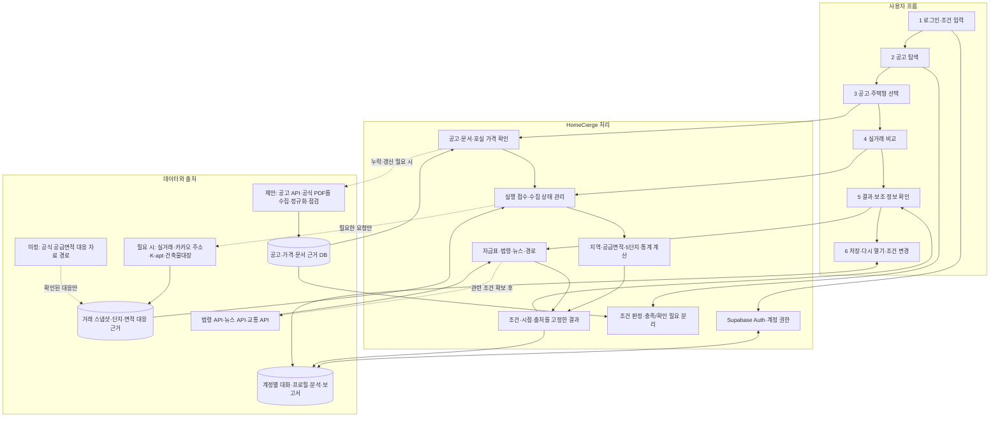
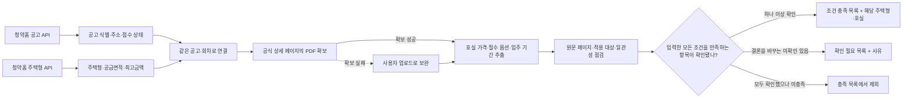
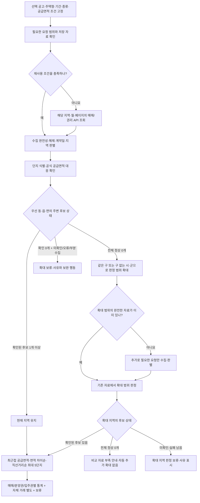
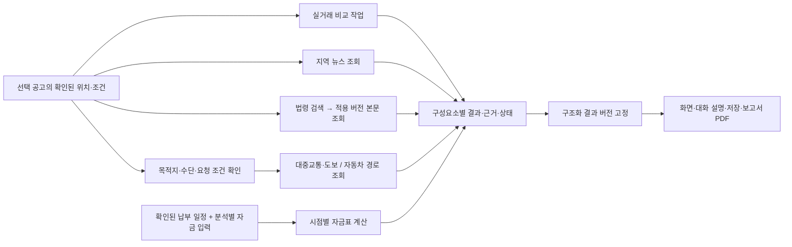

# HomeCierge 서비스 구상도 — 사용자 흐름과 데이터·API 조회 시점

2026-11-11. 화면 팀이 서비스 구상도·화면 흐름을 설계할 때 사용할 **목표 동작의 도식**이다. 확정 기능은 [PRD](prd/01-product-prd.md), 구현 순서는 [전체 개발 계획](development-plan.md)을 따른다. 현재 운영되는 완성 서비스의 흐름을 나타내지 않는다.

**권고 구조는 ‘공고 데이터를 준비 → 로그인 후 조건으로 탐색 → 한 공고·주택형 선택 → 필요한 실거래·근거 조회 → 비교와 보조 정보 제공 → 같은 결과 저장·복원’이다.** 공고·PDF 사전 처리, 부족 자료의 요청 시 보완, 보조 API의 실행 시점은 설계 제안이다. 수집 주기·재사용 유효기간·구체적인 작업 실행 서비스는 미정이다.

범례: **[확정]** PRD 제품 동작 / **[제안]** API 호출·처리 시점 / **[미정]** 자료 경로·정책 또는 기술 선택. 여기서 ‘외부 조회’는 청약·부동산·법령·뉴스·교통 등 데이터 출처의 호출을 뜻한다. 로그인·DB·파일 접근에 사용하는 Supabase API 및 HomeCierge 자체 API와 구분한다.

[사용자 단계별 통합 SVG 플로우차트](diagrams/user-journey-flowchart.svg)는 0~8단계의 사용자 행동·DB·외부 조회·판정·보류·재분석·삭제를 한 장으로 연결한다. 텍스트·도형·화살표를 벡터로 유지하며, [생성 스크립트](diagrams/render-user-journey.py)를 실행하면 같은 SVG를 다시 만들 수 있다.

[단계별로 펼쳐 보는 HTML 구상도](diagrams/service-flow.html)는 같은 내용을 전체 구조·사용자 단계·API 조회 시점·재조회 기준으로 나눈다. 아래 Mermaid 도식은 문서와 슬라이드에 맞춰 편집할 수 있는 원본이다.

## 1. 서비스 전체를 세 층으로 배치한다

화면은 로그인·사용자 입력·결과 표시를 맡고, Vercel의 자체 API는 인증·요청 접수·결과 접근을 담당한다. 오래 걸리는 수집·PDF·분석은 작업 실행기가 처리하며 배치 위치는 아직 미정이다. Supabase는 인증, DB, 비공개 파일 저장을 맡는 계획이다. 사용자 자료의 허용된 직접 Data API 접근은 현재 인계 계약을 따르며, 모든 요청이 Vercel을 거치는 것으로 단정하지 않는다.

공고·비교 자료는 출처별 허용 범위에서만 저장·재사용한다. 사용자 업로드 PDF와 그 추출값은 계정 소유로 관리하며 공유 공고 카탈로그로 자동 공개하지 않는다. 결과·문서 파일의 소유권과 접근 경계도 유지한다.

## 2. 사용자 단계에 API 호출 시점을 연결한다

| 사용자 단계·계기를 정한다 | 내부에서 읽고 처리한다 | 외부 데이터 API·문서를 언제 조회할지 제안한다 | 저장·표시할 결과를 정한다 |
| --- | --- | --- | --- |
| **0. 공통 자료를 준비한다** — 사용자와 독립된 수집 작업 [제안] | 지원 지역·유형·수집 상태 확인 | 청약홈 공고 → 주택형 → 공식 상세 페이지/첨부 PDF. 새로운 공고·문서 변경·정해질 갱신 정책에 따라 처리. 주소 확인이 필요하면 카카오 조회 | 공고 식별자·접수일·주택형·공급면적·호실 가격·필수 옵션·페이지 근거·점검 상태. 범위·완전성·조회 시점도 저장 |
| **1. 로그인하고 조건을 입력한다** [확정] | Supabase Auth 인증, 자기 대화·확인된 프로필 복원. 시·군·구 복수 선택과 예산 필수, 공급면적·입주 월 범위 선택 | 일반적인 조건 입력만으로 부동산 API를 호출하지 않음. 자연어 조건 추출에 LLM 사용은 제안이며 제공자 미정 | 이번 탐색 조건을 보존. 대화에서 제안된 변경은 확인 전 공유 프로필에 반영하지 않음 |
| **2. 조건에 맞는 공고를 찾는다** [확정] | 공고·문서 근거 DB를 읽어 같은 주택형·호실에서 적용 조건을 함께 검사. 접수 상태·정렬 적용 | 준비된 자료가 부족하거나 갱신이 필요하면 해당 공고/주택형 API와 문서 처리 작업을 요청 [제안]. 매 검색마다 전체 외부 API를 호출하지 않음 | 조건 충족 목록과 확인 필요 목록을 구분. 미수집 범위를 ‘공고 없음’으로 표현하지 않음 |
| **3. 한 공고·주택형을 고른다** [확정] | 공고·회차·주택형·호실과 PDF 점검 결과를 읽고 비교 조건을 고정 | 기존 근거로 부족하면 공고/주택형을 보완 조회하고 공식 PDF 자동 확보. 실패 시 업로드 요청. 단지 주소·좌표가 미확인이면 주소 API | 확인된 호실 소계의 최소~최대, 특정 호실 선택 시 그 금액. 문서 확보/점검 상태와 근거. 가격이 보류돼도 독립적인 정보 제공 |
| **4. 주변 실거래 비교를 실행한다** [확정] | 실행 ID·조건·규칙·기준 시점을 저장. 재사용 가능한 거래와 식별·면적 근거를 먼저 확인 | 부족한 지역·월·페이지를 매매/권리 거래 API로 조회. 후보의 식별·주소·단지 특성 확인에 필요한 카카오·K-apt·대장 자료 보완. 공급면적 대응 경로는 별도 확보 필요 | 필요한 조회와 판별 후 동·읍·면 우선, 전체 정상 0개면 상위 지역. 최대 5단지·종류별 통계·보류 사유·별도 자체 거래 |
| **5. 결과와 보조 정보를 확인한다** [확정] | 확정된 공고 위치·조건·납부 일정과 사용자가 입력한 자금·목적지를 사용 | 뉴스·법령은 공고/지역/적용 시점이 잡히면 비교와 병행 조회 [제안]. 경로는 목적지·수단 등 조건을 확보하고 조회 요청 시 호출 [제안]. 자금표는 자체 계산 | 뉴스 제목/발췌/링크, 해당 시점 법령 근거, 수단별 경로·조회 시점, 시점별 자금 부족분. 실패한 기능과 독립적인 성공 결과 분리 |
| **6. 보고서를 저장·다시 연다** [확정] | 동일한 구조화 결과를 계정별 저장. DB·비공개 파일에서 복원/다운로드 | 단순 저장·다시 열기·PDF 생성 때문에 부동산 API를 새로 조회하지 않음. 자료 이용 조건상 복원 가능한 범위 사전 확보 | 공고·주택형·조건·값·조회 시점·출처·미확인을 유지. PDF도 같은 결과 버전 사용 |
| **7. 조건을 바꾸거나 최신 자료로 재분석한다** [확정] | 승인한 변경으로 새 실행을 만들고 이전 결과 유지. 영향을 받는 구성요소만 재계산 | 새 지역·기간·출처 갱신 등에 필요한 요청만 호출 [제안]. 면적·호실·단지 교체는 기존 자료로 충족하면 재계산. 최신 자료 재조회는 정책에 맞춰 수집 | 새 조건·수집 시점·결과 버전. 공유 프로필 변경 승인과 이번 분석 변경 승인을 분리 |
| **8. 개별 자료·계정을 삭제한다** [확정] | 소유권·삭제 영향 확인 → 진행 작업의 관련 쓰기 차단 → 연관 DB·파일 정리 → 상태 안내 | 부동산 데이터 신규 수집 없음. 필요한 Auth·Storage 관리 작업은 서버에서 수행 | 삭제한 입력을 다른 기기·새 분석·늦게 끝난 작업이 복원하지 않도록 처리. 백업/파생 자료 범위는 D-06 |

‘자료 재사용 가능’은 **출처의 이용 허용 + 필요한 요청 범위의 완전성 + 고정 입력/자료 버전의 일치 + 정해질 최신성 기준**을 모두 확인한 경우다. 그 기준이 아직 미정이므로 특정 캐시 시간이나 매일 몇 시 수집 같은 주기를 확정하지 않는다. 공통 수집은 신규 공고를 사용자에게 선제 알림하는 기능과 별개이며 알림은 여전히 후속 범위다.

## 3. 공고 탐색 전에 가격 근거가 필요한 이유를 나타낸다

공고 API의 주택형 최고금액만으로 **분양가+필수 옵션**의 예산 판정을 끝낼 수 없다. PDF 처리를 공고 선택 후에만 하면 탐색 단계의 가격 판정이 보류될 수 있어, 지원 공고의 핵심 가격 근거를 사전 처리하는 안을 권고한다. 요청 시 처리하는 대안도 가능하되 미처리 상태를 조건 충족으로 추정하지 않는다. PDF가 없어도 독립적으로 확인된 기본 정보는 제공한다.

공식 PDF는 현재 구성의 전용 ‘PDF API’가 아니다. 공고의 공식 상세 페이지와 첨부 자료에서 확보하는 별도 경로다. 자동 확보 실패 시 사용자 업로드로 보완하며 같은 회차 식별·값별 점검을 거친다. 정정 적용 관계가 불명확하면 파일 수정 시각만으로 선택하지 않는다.

## 4. 실거래 조회와 지역 확대의 순서를 나타낸다

- 실거래 API의 **수집 요청 범위와 사용자에게 보여주는 비교 범위는 다르다.** 시·군·구 단위 자료를 받아도 먼저 같은 법정동·읍·면만 판정한다. 확대 지역과 API 코드의 실제 대응은 검증한다.
- **동→구 확대가 항상 추가 API 호출은 아니다.** 이미 필요한 구의 해당 월·페이지와 거래 종류를 완전하게 확보했다면 같은 스냅샷에서 판정 범위만 바꾼다.
- 기본 최근 1년은 당월을 포함한다. 예를 들어 2026-11-10 기준 2025-11-11~2026-11-10은 13개 계약월에 걸치며, 통계에는 정확한 날짜 범위만 넣는다. 호출 수는 월·페이지·거래 계열·재사용 상태에 따라 달라진다.
- 권리 API 한 계열의 응답에서 분양권·입주권을 구분하며, 모든 거래 API가 같은 지역·단지 필드를 제공한다고 가정하지 않는다.
- 한 종류라도 우선 지역에 확인된 주변 후보가 있으면 전체 비교 지역을 유지한다. 자체 거래는 주변 수와 정상 0개 판정에서 제외한다. 단지 특성 보완을 최종 5개에만 수행하면 앞선 후보 판정을 입증하지 못할 수 있으므로 판정에 필요한 후보의 근거를 먼저 확인한다.
- 확인된 공급면적 ±5% 안에서 단지별 최근접 면적의 거래만 사용한다. 전체 고유 주변 단지 최대 5개이며 종류별 통계를 나눈다. 미확인이 남으면 확인된 부분 결과를 제공하되 완전한 순위로 표시하지 않는다.

## 5. 외부 조회 목록을 서비스 시점에 대응한다

아래 이름은 저장소의 [조회 설정](api/probes.json)과 [API 인계 상태](api/prd-readiness.md)를 기준으로 한 연결 대상이다. 과거 샘플 응답 확인을 현재 제품 연동 완료로 해석하지 않는다.

| 출처·조회 이름을 찾는다 | 조회를 시작하는 조건을 정한다 | 사용하는 데이터를 구분한다 |
| --- | --- | --- |
| 청약홈 `applyhome_apt`, `applyhome_remainder` | 공고 수집/갱신, 탐색·상세의 자료 누락 | 공고 번호·주소·접수일·입주 예정·공식 상세 링크. 지원 유형 전체의 필드 대응은 추가 검증 |
| 청약홈 `applyhome_apt_model`, `applyhome_remainder_model` | 공고에 연결할 주택형 수집/갱신·누락 | 주택형·공급면적·공급 수·주택형 최고금액. 호실별 소계로 대체하지 않음 |
| 공식 상세 페이지·PDF 첨부 — 별도 확보 경로 | 공고 가격 근거 선처리 또는 선택 공고의 상세 보완·정정 확인 | 호실 가격·필수 옵션·납부 일정·조건·페이지. 확보 실패 시 업로드 |
| 국토교통부 `apt_trade` | 분석/재분석에서 필요한 지역·월·페이지가 없거나 갱신 필요 | 매매가격·계약일·전용면적·해제·단지/주소 정보 |
| 국토교통부 `apt_rights` | 위와 동일, 분석에 포함한 권리 거래 계열 | 분양권/입주권 구분·거래금액·계약일·해제. 공급면적이나 단지 식별 필드를 추정하지 않음 |
| 카카오 `kakao_address` | 공고·후보 주소/지역/좌표 확인, 목적지 주소를 좌표로 바꿀 필요 | 주소·법정동 코드·좌표. 단지 직선거리는 확인 좌표로 자체 계산 |
| K-apt `apt_list` → `apt_basic` | 후보 연결에 필요한 목록·단지 특성 근거가 없거나 갱신 필요 | 단지 코드·주소·사용승인일·세대수 등. 두 단계 조회이며 목록 누락을 전체 후보 없음으로 해석하지 않음 |
| 건축물대장 `building_title` | 단지 연결·특성 확인의 추가 근거가 필요 | 동별 주소·용도·사용승인일·세대수 등. 현재 표제부 조회를 세대 공급면적 대응 API로 표시하지 않음 |
| 공식 공급면적 대응 자료 **[경로 미정]** | 후보 거래의 공급면적을 확정할 근거가 없을 때 | 단지·주택형·시점에 대응하는 공식 면적. 확보되지 않으면 해당 비교 보류 |
| 국가법령정보 `law_search` → `law_body` | 선택 공고의 관련 조건과 적용 시점 확보 후 | 법령 검색·시행 버전 선택·해당 본문/근거. 개인 자격 자동 확정 아님 |
| NAVER API HUB `news_search` | 선택 공고의 지역과 검색 조건 확보 후 | 제목·발췌·원문 링크·게시시각. 지역성·사실 검증이나 전문 확보와 구분 |
| ODsay `odsay_route` | 단지·목적지 좌표와 요청 조건을 확보하고 대중교통 조회 요청 | 대중교통·연결 도보. 오류·도보시간 미제공을 0분으로 바꾸지 않음 |
| 자동차 경로 **[제공자 미선정]** | 자동차 경로 조회 요청 | 자동차 시간·거리·요청 조건. ODsay 대중교통 결과로 대체하지 않음 |
| LLM **[모델·호스팅 미정 / 사용 방식 제안]** | 대화 조건/변경안 구조화 또는 근거가 준비된 결과 설명 | 필요한 허용 정보만 전달. DB·외부 API 실행을 임의 결정하거나 계산·승인을 대신하지 않음 |

자금표·예산 판정·단지 직선거리·가격 통계는 **자체 계산**이다. 은행·대출 심사·세금 API를 호출하는 것으로 그리지 않는다. 자금표는 사용자 입력과 확인된 납부 일정이 필요하며 계산이 보류돼도 공고 탐색은 계속할 수 있다.

## 6. 보조 기능과 저장은 병행·분기 흐름으로 그린다

이 그림의 병행 시점은 제안이다. 뉴스·법령이 반드시 실거래 비교가 끝날 때까지 기다릴 필요는 없다. 목적지가 없으면 경로에는 입력 필요를, 자금이 없으면 자금표에는 입력 필요를 표시하고 다른 결과를 제공한다. 작업 진행과 자료의 완전성은 별도 상태로 관리한다. 이후 보조 정보가 추가되면 새 결과 버전으로 연결하며 이미 저장한 보고서는 덮어쓰지 않는다.

LLM 설명은 구조화 결과의 공고·조건·수치·상태를 따른다. ‘법령 근거 미확인’을 자격 충족으로, 일부 후보를 전체 후보로, 종료된 작업을 진행 중으로 바꾸지 않는다.

## 7. 다시 열기·재계산·재수집을 구분한다

| 사용자의 행동을 구분한다 | DB/계산으로 처리한다 | 외부 데이터 재조회 조건을 정한다 |
| --- | --- | --- |
| 같은 보고서 다시 열기·PDF 다운로드 | 저장된 결과 버전과 파일/표현 복원 | 기본적으로 없음. 새로운 현재 값으로 기존 보고서를 교체하지 않음 |
| 예산·희망 면적·입주 월을 변경해 검색 | 저장 카탈로그에서 조건 재판정 | 필요한 지역·공고 범위의 자료가 없거나 갱신 필요 시 |
| 같은 공고의 주택형·호실 변경 | 새 분석 입력으로 가격·최근접 면적·순위·통계 재계산 | 새 항목의 가격/옵션/공급면적·필요한 후보 근거가 부족한 경우 |
| 비교 기간·지역 또는 거래 종류 변경 | 사용자 확인 뒤 새 실행과 필요한 요청 범위 산출 | 기존 스냅샷이 덮지 못하는 범위·종류·갱신 대상만 |
| 비교 단지 직접 교체 | 현재 지역·같은 비교 기준·전체 5단지 안에서 검증 | 지정 단지의 필요한 거래/식별/면적 근거가 없으면 조회·보류 |
| 분석별 자금 금액·날짜 변경 | 해당 분석의 자금표 재계산 | 자금 입력 변경 자체는 외부 금융 조회 없음 |
| 목적지·수단·시간 조건 변경 | 목적지/요청 조건 확정, 해당 경로 결과 갱신 | 필요한 주소 조회 및 해당 교통수단 API. 실거래 전체를 재수집하지 않음 |
| 공유 프로필 변경 승인 | 승인 버전 확인 후 프로필만 갱신 | 승인 자체는 외부 부동산 조회 없음. 기존 분석·보고서는 유지 |
| 최신 자료로 재분석 | 새 수집 기준시점·실행·결과 생성 | 출처별 갱신 정책에 따라 거래·문서·관련 자료 조회. 기존 결과와 구분 |

## 8. 도식에 반드시 남길 표기를 정한다

1. 공고·PDF 사전 수집은 **제안**, 수집 주기·캐시 유효기간은 **미정**으로 표시한다.
2. 공식 PDF 확보와 일반 API 호출을 구분하고, 자동 확보 실패 → 업로드 → 동일 점검 기준의 분기를 둔다.
3. **공급면적 대응 자료의 미확보**와 **자동차 경로 제공자 미선정**을 별도 표시한다.
4. ‘DB에 없음’, ‘API 오류’, ‘면적 미확인’을 ‘정상 0개’와 분리한다. 정상 0개일 때만 지역 확대 화살표를 잇는다.
5. 공유 프로필·분석별 자금·저장 보고서를 다른 데이터 묶음으로 그린다. 프로필 승인이나 새 조회가 과거 결과를 덮어쓰지 않는다.
6. 외부 자료의 저장·재사용·LLM 입력·PDF 내보내기는 출처 조건에 따른다. 사용자 업로드의 공유 범위는 계정 단위로 분리한다.
7. 내부 API·Supabase 접근과 외부 데이터 조회를 다른 선/색으로 표시한다. 현재 구현된 조회 API와 목표 기능을 구분한다.

현재 인증 조회 API와 Data API 연결 방식은 [화면 팀 인계 계약](frontend-handoff.md)을 따른다. `GET /api/health`, `GET /api/ready`, `GET /api/v1/me`의 기반이 있으며, 위 도식의 탐색·분석·작업·PDF·보조 기능·삭제 API는 개발 대상이다. 구현 전 경로 이름은 개발 계획의 제안으로 남기고 이 구상도에서 새 API 계약으로 확정하지 않는다.
